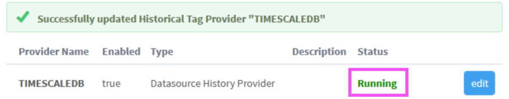
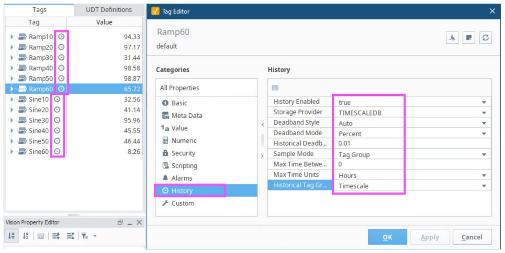
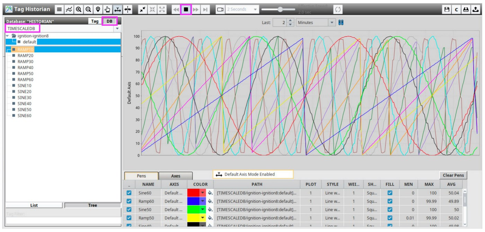

# Hypertable setup

Turn Ignition's history table into a TimescaleDB hypertable, add compression and retention, tune it, and switch history back on.
{ .lead }

Run the SQL on the **database host**, connected to the `tsdb` database as a superuser. This must come **after** [Ignition setup](ignition-setup.md): the table `sqlth_1_data` has to exist, and the history provider must be disabled while you convert it.

=== "Ubuntu"

    ```bash title="bash"
    sudo -i -u postgres
    psql
    ```

=== "Windows"

    ```powershell title="powershell"
    psql -U postgres
    ```

```sql title="psql"
\c tsdb
SELECT * FROM sqlth_1_data;
```

The select must show the few samples Ignition wrote earlier. If it says the table does not exist, go back to [Ignition setup, step 4](ignition-setup.md#4-let-ignition-create-the-history-table).

## 1. Convert the table to a hypertable

```sql title="psql"
SELECT * FROM create_hypertable('sqlth_1_data','t_stamp', if_not_exists => True, chunk_time_interval => 86400000, migrate_data => True);
```

- **`t_stamp`** is the time column. Ignition stores it as a number: milliseconds since 1970.
- **`chunk_time_interval => 86400000`** is 24 hours in milliseconds, so Timescale starts a new chunk (a small internal table) every day.
- **`migrate_data => True`** moves the existing rows into chunks. This can take a while on a table that already holds a lot of data.

Two warnings are harmless: `stringvalue` is `character varying` (Timescale prefers `TEXT`) and `datevalue` is `timestamp without time zone` (it prefers `TIMESTAMPTZ`). Ignition owns that table layout, so leave them. A `NOTICE` that data is migrating to chunks is normal. The result row `created = t` confirms the hypertable exists.

## 2. Turn on compression

```sql title="psql"
ALTER TABLE sqlth_1_data SET (timescaledb.compress, timescaledb.compress_orderby = 't_stamp DESC', timescaledb.compress_segmentby = 'tagid');
```

This groups compressed data by tag (`tagid`) and sorts it newest first, which suits trend queries for one tag.

## 3. Tell Timescale what "now" is

Policies decide which chunks are old enough to act on, and they need the current time in the same units as the table's time column. A number-based time column has no built-in clock, so give it one: a small function that returns the current time in milliseconds.

```sql title="psql"
CREATE OR REPLACE FUNCTION unix_now() returns BIGINT LANGUAGE SQL STABLE as $$ SELECT (extract(epoch from now())*1000)::bigint $$;
```

```sql title="psql"
SELECT set_integer_now_func('sqlth_1_data', 'unix_now');
```

The empty result with one row is normal. Per the PDF, policies that act on chunks of a certain age need this function on a table with a number-based time column, so do not skip it.

## 4. Add the compression and retention policies

Two background jobs keep the database small:

- **Compression** compresses a chunk once all of it is older than the age you set.
- **Retention** drops a chunk once all of it is older than the age you set. Dropping is permanent.

Both ages are in **milliseconds**, because the time column is. Because chunks are 24 hours long, the jobs act on whole days at a time. Keep the retention age longer than the compression age.

| Age | Milliseconds |
| --- | --- |
| 7 days | `604800000` |
| 30 days | `2592000000` |
| 31 days | `2678400000` |
| 366 days (one year) | `31622400000` |

Choose one of the two sets below. Both come from the lab documents.

=== "One year of history"

    The [Setup PDF](TimescaleDB%20+%20Ignition%20Setup.pdf#page=10) uses this for a historian with a one-year retention policy: compress after 31 days, keep 366 days.

    ```sql title="psql"
    SELECT add_compression_policy('sqlth_1_data', BIGINT '2678400000');
    SELECT add_retention_policy('sqlth_1_data', BIGINT '31622400000');
    ```

=== "30 days of history"

    A short-lived test or a small disk: compress after 7 days, keep 30 days.

    ```sql title="psql"
    SELECT add_compression_policy('sqlth_1_data', compress_after => 604800000);
    SELECT add_retention_policy('sqlth_1_data', drop_after => 2592000000);
    ```

Each call returns a job number, for example `1000` for compression and `1001` for retention. Only one retention policy can exist per hypertable.

!!! note "Enterprise licence not needed"

    The first version of this guide used `add_compress_chunks_policy` and `add_drop_chunks_policy`, and said automatic dropping needed the enterprise edition. That is no longer true: `add_compression_policy` and `add_retention_policy` replace them, and the old fallback of running `drop_chunks` from your own schedule is not needed.

### Choose when the jobs run

By default each job starts one interval after the previous start, so the time of day drifts. A fixed schedule makes them run at a set time every day. First look up the job numbers, because yours may not be 1000 and 1001:

```sql title="psql"
SELECT job_id, proc_name, schedule_interval, scheduled, fixed_schedule, next_start FROM timescaledb_information.jobs WHERE hypertable_name = 'sqlth_1_data';
```

Then set a start time for each. This example runs retention every day at 20:10 and compression 5 minutes after, in the UTC-6 time zone. Use your own job numbers, dates and time zone.

```sql title="psql"
SELECT alter_job(1000, fixed_schedule => true, initial_start => '2024-02-08 20:15:00.000000-06', next_start => '2024-02-09 20:15:00.000000-06');
SELECT alter_job(1001, fixed_schedule => true, initial_start => '2024-02-08 20:10:00.000000-06', next_start => '2024-02-09 20:10:00.000000-06');
```

With `fixed_schedule` set to `true` the job runs on the clock, every interval from its set start. With `false` the next run is the last finish plus the interval.

### Check the jobs, and check them again after the first run

```sql title="psql"
SELECT job_id, application_name, schedule_interval, retry_period, scheduled, fixed_schedule, config, next_start, hypertable_name FROM timescaledb_information.jobs WHERE hypertable_name = 'sqlth_1_data';
```

Both jobs must show `scheduled = t`. After the first scheduled run (next day), check the statistics. `last_run_status` must be `Success` and `total_failures` must be `0`:

```sql title="psql"
SELECT job_id, last_successful_finish, last_run_status, job_status, next_start, total_runs, total_failures FROM timescaledb_information.job_stats WHERE hypertable_name = 'sqlth_1_data';
```

## 5. Indexes, reindex and autovacuum

### Add a BRIN index

A BRIN (Block Range INdex) is a very small index that works well on data written in time order, which is how a historian writes. It is what keeps queries fast as the table grows to tens or hundreds of GB.

```sql title="psql"
CREATE INDEX sqlth_1_data_tagid_t_stamp_brinx ON sqlth_1_data USING BRIN (tagid, t_stamp) with (pages_per_range=64, autosummarize = on);
```

List the indexes:

```sql title="psql"
SELECT indexname, indexdef FROM pg_indexes WHERE tablename = 'sqlth_1_data';
```

There are now three. `sqlth_1_data_pkey` (on `tagid, t_stamp`) and `sqlth_1_datat_stampndx` (on `t_stamp`) were created by Ignition, and the BRIN index is yours.

!!! warning "Optional, and not verified here: disabling the `t_stamp` index"

    The PDF disables the second Ignition index to save space, by editing the system catalog directly:

    ```sql title="psql"
    UPDATE pg_index SET indisvalid = false WHERE indexrelid = 'sqlth_1_datat_stampndx'::regclass;
    ```

    This edits PostgreSQL's own tables, so it is a superuser-only shortcut. The PDF then runs `REINDEX` straight after, and a reindex rebuilds invalid indexes, so this step may be undone. If you use it, check `indisvalid` for that index after the reindex. If you are unsure, skip it.

### Reindex the table

```sql title="psql"
REINDEX (VERBOSE) TABLE public.sqlth_1_data;
```

It reports each index on each chunk as it rebuilds it. Finish with the single word `REINDEX`.

### See the index working (optional)

This needs some history to have built up. Replace the time range with timestamps (in milliseconds) that exist in your data:

```sql title="psql"
EXPLAIN (ANALYZE) SELECT * FROM public.sqlth_1_data WHERE tagid = 1 and t_stamp between 1707524933560 and 1708525044573;
```

Look for `Bitmap Index Scan on …_sqlth_1_data_tagid_t_stamp_brinx` in the plan. In the lab that query returned about 25,000 rows in 23 ms.

### Tune autovacuum for this table

A historian writes constantly, so tell PostgreSQL to clean and analyse this table more often than the default:

```sql title="psql"
ALTER TABLE sqlth_1_data SET (autovacuum_enabled = on, autovacuum_analyze_scale_factor = 0.01, autovacuum_vacuum_scale_factor = 0.05, autovacuum_analyze_threshold = 500, autovacuum_vacuum_threshold = 1000);
```

Leave `psql` with `\q`, then `exit` to return to your own account.

## 6. Turn history back on

On the **Ignition Gateway**:

1. Go to **Config**, **Tags**, **History**, `TIMESCALEDB` and **re-enable** the provider.

    <figure markdown="span">
      { loading=lazy }
      <figcaption>Fig. 14. The provider is enabled again: Enabled <code>true</code>, status <strong>Running</strong>.</figcaption>
    </figure>

2. In the Designer, open the project and enable history on all the remaining tags with **Storage Provider** `TIMESCALEDB` and **Historical Tag Group** `Timescale`. For real tags, use the storage provider and tag group you actually want.

    <figure markdown="span">
      { loading=lazy }
      <figcaption>Fig. 15. The History settings, with the clock icons in the Tag Browser showing which tags have history on.</figcaption>
    </figure>

3. Check that data arrives: a Vision startup page with an Easy Chart, or a similar trend, shows the history of all 12 test tags. The PDF used the *Ad Hoc Trends* component by Matthew Raybourn from the [Ignition Exchange](https://inductiveautomation.com/exchange/46/overview). Open the project in the Vision Client Launcher to see it.

    <figure markdown="span">
      { loading=lazy }
      <figcaption>Fig. 16. Near-real-time trending of all 12 simulated tags from TimescaleDB.</figcaption>
    </figure>

Next: [maintenance queries](maintenance.md), including the check of the first scheduled job run.

## Newer TimescaleDB versions

Everything above was tested on **TimescaleDB 2.13.1**. Check which version you have:

```sql title="psql"
SELECT extversion FROM pg_extension WHERE extname = 'timescaledb';
```

From version 2.18, Timescale renamed compression to *columnstore* ("hypercore"). The old compression functions are deprecated, not removed, and Timescale's documentation says they remain supported, so this guide's commands still work. For new work you may want the new names:

| This guide (2.13) | Newer name |
| --- | --- |
| `add_compression_policy()` | `add_columnstore_policy()` |
| `timescaledb.compress` | `timescaledb.enable_columnstore` |
| `timescaledb.compress_segmentby` | `timescaledb.segmentby` |
| `timescaledb.compress_orderby` | `timescaledb.orderby` |

Things to know if you are on a newer version:

- From 2.20 the compression job is listed as **Columnstore Policy**, so the `proc_name` in the job queries above reads differently.
- A GitHub issue reports a setup script on version 2.21 failing with "columnstore not enabled" ([issue #8600](https://github.com/timescale/timescaledb/issues/8600)). Keep the order used in this guide: `ALTER TABLE` first, the policy after.
- The deprecation notice said the old names would go in a later major release. Read the [`add_compression_policy` page](https://docs.tigerdata.com/api/latest/compression/add_compression_policy/) and the [`add_columnstore_policy` page](https://docs.timescale.com/api/latest/hypercore/add_columnstore_policy/) for your version before you rely on either.

Sources for this section: [timescaledb pull request 7443](https://github.com/timescale/timescaledb/pull/7443) (the renamed functions and settings), the two documentation pages above, and the [timescaledb-python update notes](https://github.com/jmitchel3/timescaledb-python/blob/main/docs/timescale-recent-updates.md).

Tiger Data, the company behind TimescaleDB, also publishes its own [Ignition and TimescaleDB write-up](https://www.tigerdata.com/blog/ignition-and-timescaledb-perfect-pairing) with the same core steps: disable partitioning, convert `sqlth_1_data` with a millisecond chunk interval, then add compression and retention.
