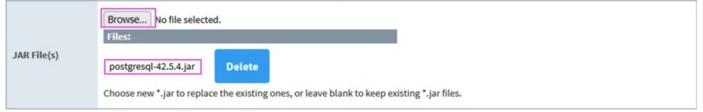
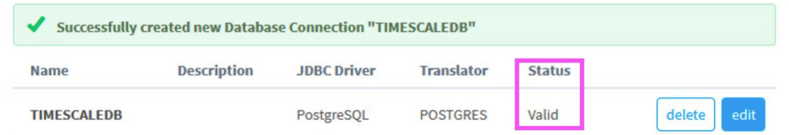
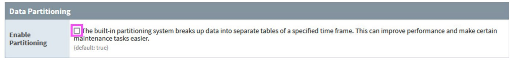
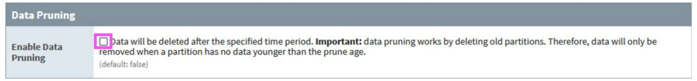
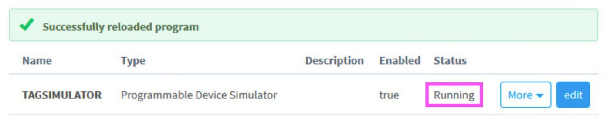
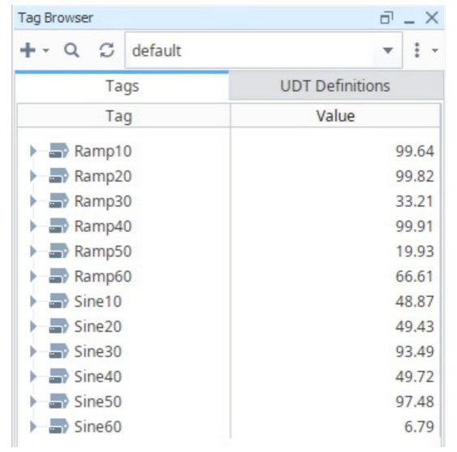
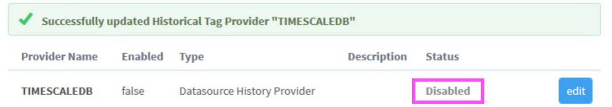
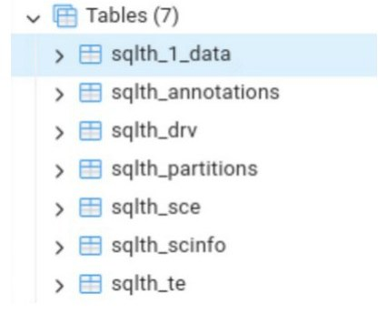
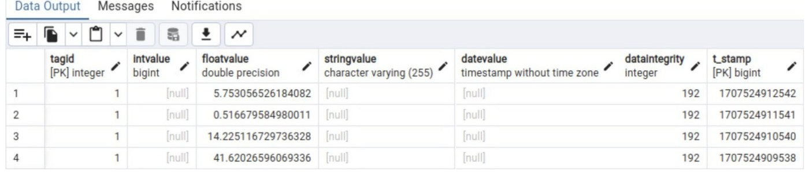

# Ignition setup

Connect the Gateway to the new database, switch off Ignition's own partitioning and pruning, and let Ignition create its history table.
{ .lead }

Run these on the **Ignition Gateway**. Menu paths and screenshots are from Ignition 8.1 ([Setup PDF](TimescaleDB%20+%20Ignition%20Setup.pdf#page=7), pages 7 to 9). Tiger Data's guide uses different menu names for the same steps; they are listed below.

!!! note "Menu names in the Tiger Data guide"

    [Tiger Data's Ignition guide](https://www.tigerdata.com/docs/integrate/data-ingestion-streaming/ignition) (undated, read on 30 October 2026) names the screens differently. We have not run these on a Gateway, so treat the mapping as a pointer:

    | This page (Ignition 8.1, from the PDF) | Tiger Data's guide |
    | --- | --- |
    | **Config**, **DATABASES**, **Connections**, **Create new Database Connection** | **Connections**, **Database Connections**, **Create Database Connection +** |
    | **Config**, **TAGS**, **History**, new **Database** historian provider | **Services**, **Historians**, **Create Historian +**, **SQL Historian** |

## 1. Update the JDBC driver

!!! warning "The two sources disagree on this"

    The Setup PDF (Ignition 8.1.37) says Ignition ships a PostgreSQL JDBC driver of version 9.x that **does not support hypertable features**, and replaces it. Tiger Data's guide says the PostgreSQL driver is "included in every standard Ignition install" and does not replace it. We could not test either way.

    A hypertable lives in the database, so the driver version should not decide whether it works, but a very old driver can fail to connect, especially to a server using `scram-sha-256` passwords. A safe order: check the driver version listed in the Gateway; if it is older than 42.x, or the connection in step 2 fails, replace it as below.

1. Download the latest PostgreSQL JDBC driver (a file such as `postgresql-42.x.y.jar`) from [jdbc.postgresql.org](https://jdbc.postgresql.org/) to the Gateway machine.
2. In the Gateway go to **Config**, **DATABASES**, **Drivers**, **PostgreSQL**, **Edit**.
3. Click **Choose File**, select the downloaded `.jar`, and click **Save Changes**.

    <figure markdown="span">
      { loading=lazy }
      <figcaption>Fig. 5. The JAR File(s) box. The lab used <code>postgresql-42.5.4.jar</code>; use the current 42.x release.</figcaption>
    </figure>

4. Check the file is now in `C:\Program Files\Inductive Automation\Ignition\user-lib\jdbc`.

## 2. Add the database connection

Go to **Config**, **DATABASES**, **Connections**, **Create new Database Connection**, **PostgreSQL**, **Next**, and fill in:

| Setting | Value |
| --- | --- |
| Name | `TIMESCALEDB` |
| JDBC Driver | `PostgreSQL's` |
| Connect URL | `jdbc:postgresql://<database-host-ip>:5432/tsdb` |
| Username | `ignition` |
| Password | the password you set in [Database access](database-access.md) |

Leave the other settings at their defaults and click **Create New Database Connection**. The connection status must read **Valid**.

<figure markdown="span">
  { loading=lazy }
  <figcaption>Fig. 6. The new connection, with status <strong>Valid</strong>.</figcaption>
</figure>

If it does not, the cause is almost always the network side: check the [firewall and `pg_hba.conf` steps](database-access.md#let-the-ignition-gateway-connect).

!!! note "Windows setup"

    The [Documentation PDF](TimescaleDB%20Documentation.pdf#page=3) connected as `postgres` with the `postgres` password. A dedicated user, as above, limits the damage if the Gateway's credentials leak.

## 3. Set up the history provider

Go to **Config**, **TAGS**, **History** and open the historian for this connection (the PDF names it `TIMESCALEDB`). If there is none yet, the same page has the button to create a new **Database** historian provider; select the `TIMESCALEDB` connection in it.

!!! danger "Turn off Data Partitioning and Data Pruning"

    **Disable both.** Timescale's hypertable does both jobs. If Ignition's own partitioning stays on, it starts new tables (`sqlth_1_data`, then another when the partition length passes) instead of filling one, and the hypertable setup no longer matches the data. Tiger Data gives the same reason: partitioning left on makes Ignition "create multiple history tables" once the historian runs past the partition length. Click **Save Changes**.

    Tiger Data's guide only mentions partitioning. The PDF also disables pruning, since pruning works by deleting old partitions and Timescale's retention policy replaces it. Disabling both is the safe choice.

<figure markdown="span">
  { loading=lazy }
  <figcaption>Fig. 7. Data Partitioning: <strong>Enable Partitioning</strong> unticked (the default is on).</figcaption>
</figure>

<figure markdown="span">
  { loading=lazy }
  <figcaption>Fig. 8. Data Pruning: <strong>Enable Data Pruning</strong> unticked.</figcaption>
</figure>

## 4. Let Ignition create the history table

Ignition only creates its history tables the first time a tag is historized. The hypertable conversion needs that table to exist, so you trigger it on purpose, with the smallest possible amount of data.

Tiger Data's guide gets the table the same way ("creating any tag and setting `History Enabled` to `True`") and does not turn history off again. It converts while data keeps flowing, and its [blog post](https://www.tigerdata.com/blog/ignition-and-timescaledb-perfect-pairing) warns that converting a large existing table "takes time and locks the table while it runs". Switching history off first, as the PDF does, keeps the table nearly empty so the conversion is instant. Both work; the PDF's way is safer, and is easiest to do **before** real data arrives.

This section uses a simulator so the steps work on an empty Gateway. **If you already have real tags**, skip the simulator and the project: turn history on for one real tag to the new provider, then follow the same turn-it-off steps below.

### a) A test device and 12 test tags

Go to **Config**, **OPC UA**, **Devices**, **Create new Device**, **Programmable Device Simulator**, **Next**:

| Setting | Value |
| --- | --- |
| Name | `TAGSIMULATOR` |
| Enabled | `True` |
| Repeat Program | `True` |
| Base Rate (ms) | `1000` |

Click **Create New Device**. Create a text file `tags_sim_program.csv` in your Downloads folder with this content:

```csv title="tags_sim_program.csv"
Time Interval, Browse Path, Value Source, Data Type
"0","Ramp/Ramp10","ramp(0.0, 100.0, 10, true)","Float"
"0","Ramp/Ramp20","ramp(0.0, 100.0, 20, true)","Float"
"0","Ramp/Ramp30","ramp(0.0, 100.0, 30, true)","Float"
"0","Ramp/Ramp40","ramp(0.0, 100.0, 40, true)","Float"
"0","Ramp/Ramp50","ramp(0.0, 100.0, 50, true)","Float"
"0","Ramp/Ramp60","ramp(0.0, 100.0, 60, true)","Float"
"0","Sine/Sine10","sine(0.0, 100.0, 10, true)","Float"
"0","Sine/Sine20","sine(0.0, 100.0, 20, true)","Float"
"0","Sine/Sine30","sine(0.0, 100.0, 30, true)","Float"
"0","Sine/Sine40","sine(0.0, 100.0, 40, true)","Float"
"0","Sine/Sine50","sine(0.0, 100.0, 50, true)","Float"
"0","Sine/Sine60","sine(0.0, 100.0, 60, true)","Float"
```

Then open the device: **Config**, **OPC UA**, **Devices**, `TAGSIMULATOR`, **More**, **edit program**. Set **Load Program** to **Load from CSV**, click **Browse…**, choose the file, click **Open**, then **Load Simulator Program**. The list of simulated tags appears. Click **Save Program** and check the device status is **Running**.

<figure markdown="span">
  { loading=lazy }
  <figcaption>Fig. 9. The simulator device is running.</figcaption>
</figure>

### b) A project with the tags

1. In the **Designer**, create a new project (the PDF calls it `TIMESCALE`).
2. In the **Tag Browser**, click **+**, then **Browse Devices…**. Expand **Ignition OPC UA Server** to the **Ramp** folder. Hold Shift to select all its tags and add them with the **→** key to the default provider. Do the same for **Sine**. Click **OK**. The Tag Browser must look like this:

<figure markdown="span">
  { loading=lazy width="340" }
  <figcaption>Fig. 10. The 12 simulator tags in the default provider.</figcaption>
</figure>

### c) A tag group for Timescale

In the Tag Browser, open the tag group editor (**Edit Group Tags**) and add a group:

| Setting | Value |
| --- | --- |
| Name | `Timescale` |
| Mode | `Direct` |
| Rate (ms) | `1000` |
| Data Mode | `Subscribed` |
| Min Time Between Samples | `1 sec` |
| Max Time Between Samples | `1 min` |

Click **OK**.

### d) Create the table, then switch history off

Double-click the `Sine10` tag. In the **Tag Editor**, open the **History** category and set:

| Setting | Value |
| --- | --- |
| History Enabled | `true` |
| Storage Provider | `TIMESCALEDB` |
| Deadband Mode | `Percent` |
| Historical Deadband | `0.01` |
| Sample Mode | `Tag Group` |
| Historical Tag Group | `Timescale` |

!!! danger "Keep this quick"

    Click **Apply**, and within **2 to 5 seconds** (the PDF's figure) set **History Enabled** back to `false` and click **Apply** again. You only want Ignition to create the tables and write a few samples. At the end there must be **no tag** with history enabled for the `TIMESCALEDB` provider.

    The [PDF](TimescaleDB%20+%20Ignition%20Setup.pdf#page=9) says to switch back "the `Ramp10` tag". It only enabled history on `Sine10`, so this is almost certainly a typo: turn off the tag you turned on.

Then go to **Config**, **Tags**, **History**, `TIMESCALEDB` and **disable the provider** itself, so nothing writes to the table while you convert it.

<figure markdown="span">
  { loading=lazy }
  <figcaption>Fig. 11. The provider is disabled: Enabled <code>false</code>, status <strong>Disabled</strong>.</figcaption>
</figure>

## 5. Check the tables in pgAdmin

On the database host open pgAdmin and go to **Servers**, your server, **Databases**, **tsdb**, **Schemas**, **public**, **Tables**. Ignition has created a set of tables.

<figure markdown="span">
  { loading=lazy width="320" }
  <figcaption>Fig. 12. The seven tables Ignition creates, in the <code>public</code> schema.</figcaption>
</figure>

The data table is named **`sqlth_1_data`**. The number is managed by the Gateway:

- A setup from scratch on the same Gateway creates `sqlth_2_data`, then `sqlth_3_data`, and so on.
- If you see a table name in any other format, the history provider is misconfigured. The usual cause is **Data Partitioning left enabled**, from step 3.

You can run the SQL in this guide in pgAdmin's **Query Tool**, with `psql`, or, as Tiger Data suggests, in Ignition's own [Simple Database Editor](https://www.docs.inductiveautomation.com/docs/7.9/sql-in-ignition/common-sql-tasks/simple-database-editor).

Right-click `sqlth_1_data`, choose **Query Tool**, and run:

```sql
SELECT * FROM public.sqlth_1_data;
```

The output must show a few recorded samples of the tag.

<figure markdown="span">
  { loading=lazy }
  <figcaption>Fig. 13. Four samples for tag 1. <code>dataintegrity</code> 192 means good quality, and <code>t_stamp</code> is milliseconds since 1970.</figcaption>
</figure>

Next: [turn the table into a hypertable](hypertable.md).
