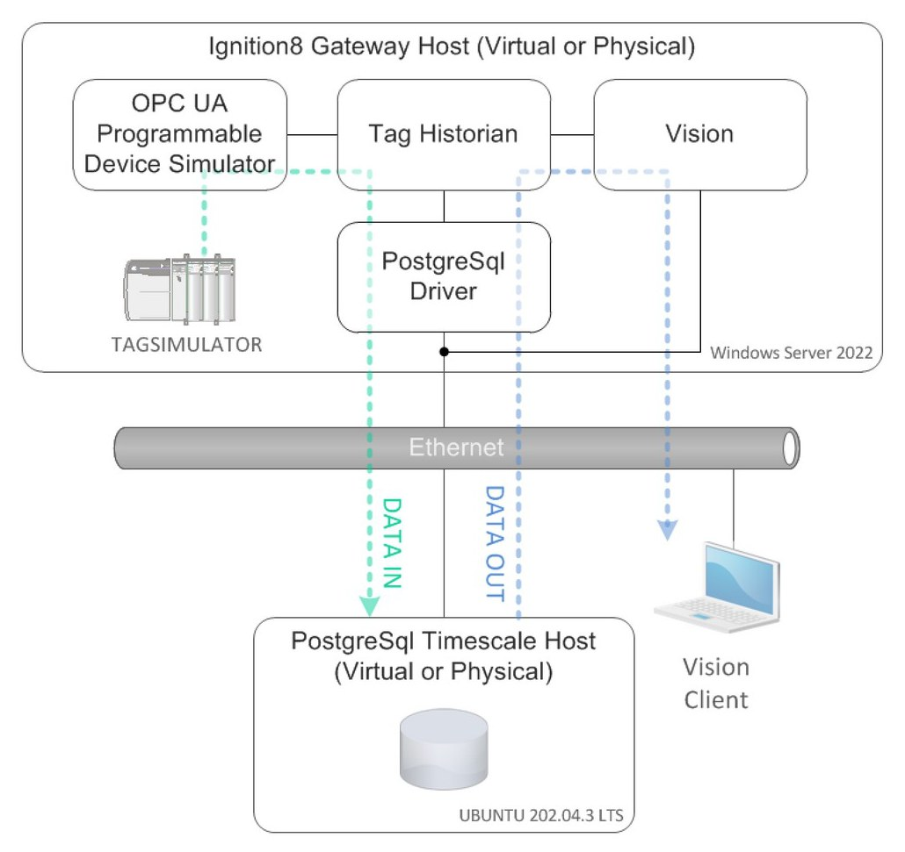

# TimescaleDB with Ignition

Use PostgreSQL with the TimescaleDB extension as the database behind Ignition's Tag Historian. The historian table becomes a *hypertable* that compresses and deletes old data by itself, so the database needs no maintenance plan.
{ .lead }

PostgreSQL TimescaleDB 2.13 Ignition 8.1 Historian Windows or Ubuntu

!!! note "What this guide was tested on"

    The steps come from two documents kept on this site: the [Setup PDF](TimescaleDB%20+%20Ignition%20Setup.pdf) (Ubuntu 22.04, PostgreSQL 14.10, TimescaleDB 2.13.1, Ignition 8.1.37 LTS, pgAdmin 4 8.2, February 2024) and the [Documentation PDF](TimescaleDB%20Documentation.pdf) (Windows, PostgreSQL 16, TimescaleDB 2.13.1). It has not been re-run on newer versions. Check [Newer TimescaleDB versions](hypertable.md#newer-timescaledb-versions) before using a version after 2.13.

    It was also compared, on 30 October 2026, with Tiger Data's own [Ignition integration guide](https://www.tigerdata.com/docs/integrate/data-ingestion-streaming/ignition) and [blog post](https://www.tigerdata.com/blog/ignition-and-timescaledb-perfect-pairing). Where they differ from the PDFs, the page says so. Nothing here was tested on a live system.

## Why PostgreSQL with TimescaleDB

The usual alternative is Microsoft SQL Server, and it has two problems for a historian:

- **Maintenance.** The SQL Server log file grows until it fills the disk unless someone builds and runs a maintenance plan. Express edition also limits CPU and database size, and Standard edition needs a paid licence.
- **Slow queries over time.** Performance drops as history piles up, roughly after a year of data for 5000 or more tags.

PostgreSQL with TimescaleDB is free for commercial use. Two background jobs replace the maintenance plan: one compresses old data, the other deletes data past the retention age. These only work on a hypertable, which is why the extension is needed. A BRIN index keeps queries fast as the table grows to tens or hundreds of GB.

### A small test of the difference

The [Documentation PDF](TimescaleDB%20Documentation.pdf) compares the two on one Windows laptop (Intel Core i7-1165G7, 16 GB RAM), running `SELECT * FROM stocks_real_time;` on 5 million rows, averaged over 10 runs.

| | SQL Server | PostgreSQL + TimescaleDB | Difference |
| --- | --- | --- | --- |
| Query time | 43.6 s (± 12 s) | 3.302 s (± 1.5 s) | 92% less time |
| Storage | 762 MB | 61 MB | 92% smaller |

It was called a preliminary result, and the query is a plain full-table read on a stock-price table, not an Ignition history query. Treat it as a rough guide.

## Pick your path

-   :material-microsoft-windows:{ .lg .middle } **Windows**

    ---

    PostgreSQL with `winget` or the installer, then the TimescaleDB setup program.

    [:octicons-arrow-right-24: Install on Windows](install-windows.md){ .card-main }

-   :material-ubuntu:{ .lg .middle } **Ubuntu 22.04**

    ---

    PostgreSQL and TimescaleDB from `apt`, tuned with `timescaledb-tune`, with pgAdmin.

    [:octicons-arrow-right-24: Install on Ubuntu](install-ubuntu.md){ .card-main }

## The whole job, in order

The order matters. Ignition must create its history table before it can be converted, so the Ignition steps and the database steps alternate.

| Step | Where | Page |
| --- | --- | --- |
| 1. Install PostgreSQL and TimescaleDB | Database host | [Windows](install-windows.md) or [Ubuntu](install-ubuntu.md) |
| 2. Create the user and database, allow remote connections | Database host | [Database access](database-access.md) |
| 3. Update the JDBC driver, add the connection, turn off partitioning and pruning | Ignition Gateway | [Ignition setup](ignition-setup.md) |
| 4. Make Ignition create `sqlth_1_data` | Ignition Designer | [Ignition setup](ignition-setup.md#4-let-ignition-create-the-history-table) |
| 5. Convert the table to a hypertable, add compression, retention and indexes | Database host | [Hypertable setup](hypertable.md) |
| 6. Turn the history provider back on and enable history on all tags | Ignition Gateway and Designer | [Hypertable setup](hypertable.md#6-turn-history-back-on) |
| 7. Check that the jobs run, then maintain | Database host | [Maintenance](maintenance.md) |
| Moving existing history from SQL Server | Both | [Migrate from SQL Server](migrate-from-mssql.md) |

## Before you start

The lab used two machines, one for the Ignition Gateway (with the simulator, the Tag Historian and a Vision client) and one for the database, joined by Ethernet.

<figure markdown="span">
  { loading=lazy width="520" }
  <figcaption>Fig. 1. The lab: data flows in from the tag historian over the PostgreSQL driver and out to the Vision client. Both hosts were virtual machines.</figcaption>
</figure>

- **Two machines** (virtual or physical): the database host and the Ignition Gateway. One machine also works for a test.
- **Internet access** on the database host while installing.
- **Knowledge:** Ignition 8, basic networking, and basic SQL. You do not need to know PostgreSQL.
- **Downloads and credits:** the Ubuntu steps are based on the [Timescale Linux installation guide](https://docs.timescale.com/self-hosted/latest/install/installation-linux/). The [Setup PDF](TimescaleDB%20+%20Ignition%20Setup.pdf) is © 2024 Agile Automation Technology, LLC, by Peter Tiagunov.

!!! danger "Two shortcuts in the original PDFs that you should not copy"

    - **`trust` authentication from `0.0.0.0/0`** in `pg_hba.conf` lets any machine that can reach port 5432 connect as any database user with no password. [Database access](database-access.md#let-the-ignition-gateway-connect) shows how to allow only the Gateway.
    - **The sample password `12345`** for the `ignition` user. Use a long random password.

## Where the PDFs fit

This site has the same material as the two PDFs in written form, with corrections and the order of steps made explicit. The 16 figures of the Setup PDF are placed beside the steps they belong to, cropped from the PDF and numbered as in it (Fig. 1 to 16). The PDFs remain available in full.

- [TimescaleDB + Ignition Setup (PDF, 17 pages)](TimescaleDB%20+%20Ignition%20Setup.pdf)
- [TimescaleDB Documentation (PDF, 4 pages)](TimescaleDB%20Documentation.pdf)
