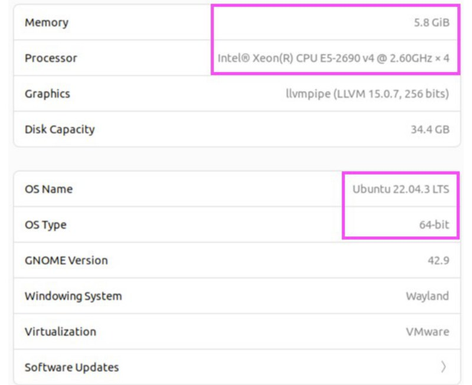
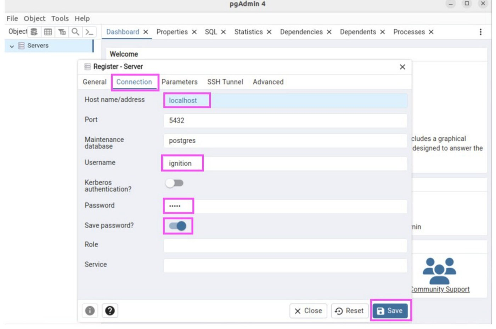
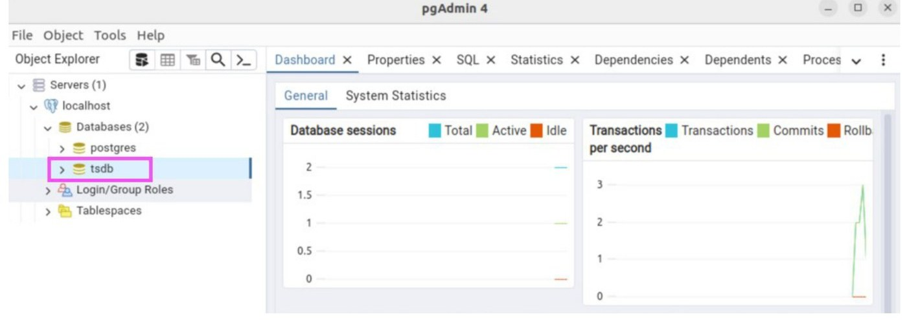

# Install on Ubuntu

PostgreSQL, TimescaleDB and pgAdmin on Ubuntu 22.04 LTS, from the project's `apt` repositories.
{ .lead }

!!! note "Tested on"

    Ubuntu 22.04.4 (jammy), PostgreSQL 14.10, TimescaleDB 2.13.1, pgAdmin 4 version 8.2, from the [Setup PDF](TimescaleDB%20+%20Ignition%20Setup.pdf#page=2). The host needs internet access. Replace `14` in the package names with the PostgreSQL version you install.

Check the Ubuntu version first: **Settings**, then **About**. The lab host was Ubuntu 22.04.3 LTS, 64-bit.

<figure markdown="span">
  { loading=lazy width="520" }
  <figcaption>Fig. 2. Settings, About on the database host.</figcaption>
</figure>

## 1. Install PostgreSQL

```bash title="bash"
sudo apt install gnupg postgresql-common apt-transport-https lsb-release wget
sudo /usr/share/postgresql-common/pgdg/apt.postgresql.org.sh
```

The second command enables the official PostgreSQL repository. Press Enter when it asks.

## 2. Add the Timescale repository and install TimescaleDB

```bash title="bash"
echo "deb https://packagecloud.io/timescale/timescaledb/ubuntu/ $(lsb_release -c -s) main" | sudo tee /etc/apt/sources.list.d/timescaledb.list
wget --quiet -O - https://packagecloud.io/timescale/timescaledb/gpgkey | sudo gpg --dearmor -o /etc/apt/trusted.gpg.d/timescaledb.gpg
sudo apt update
sudo apt install timescaledb-2-postgresql-14
```

## 3. Tune PostgreSQL for TimescaleDB

`timescaledb-tune` edits `postgresql.conf` for the machine's memory and CPU. Answer `y` to every question.

```bash title="bash"
sudo timescaledb-tune
```

It asks, in order:

1. **Is this the right `postgresql.conf`?** The path is `/etc/postgresql/14/main/postgresql.conf`.
2. **Add `shared_preload_libraries = 'timescaledb'`?** This one is required. Without it the extension cannot load.
3. **Tune memory, parallelism, WAL, background writer and miscellaneous settings?** The recommendations depend on the machine. The lab had 5.78 GB of memory and 4 CPUs, and the tool chose `shared_buffers = 1479MB`, `max_connections = 75` and 16 TimescaleDB background workers.

!!! note "Keep the backup"

    It writes a backup first, for example `/tmp/timescaledb_tune.backup202402012318`. Copy it somewhere safe if you want a way back.

## 4. Install the `psql` client

```bash title="bash"
sudo apt-get update
sudo apt-get install postgresql-client
```

The lab's apt installed client version 16 against server version 14. The `psql` banner warns about the mismatch but it works.

## 5. Restart PostgreSQL and start it at boot

```bash title="bash"
sudo systemctl restart postgresql
sudo systemctl enable postgresql.service
```

## 6. Install pgAdmin 4

pgAdmin is the graphical database editor used in the rest of this guide.

```bash title="bash"
sudo snap install curl
curl -fsS https://www.pgadmin.org/static/packages_pgadmin_org.pub | sudo gpg --dearmor -o /usr/share/keyrings/packages-pgadmin-org.gpg
sudo sh -c 'echo "deb [signed-by=/usr/share/keyrings/packages-pgadmin-org.gpg] https://ftp.postgresql.org/pub/pgadmin/pgadmin4/apt/$(lsb_release -cs) pgadmin4 main" > /etc/apt/sources.list.d/pgadmin4.list && apt update'
sudo apt install pgadmin4 -y
```

The `i386` message from `apt update` is harmless.

To use it: click **Show Applications**, then **pgAdmin4**. Right-click **Servers**, choose **Register**, then **Server…**, enter a name, open the **Connection** tab, fill in the connection details and click **Save**.

<figure markdown="span">
  { loading=lazy }
  <figcaption>Fig. 3. Register Server, Connection tab. The boxes mark the tab, the host (<code>localhost</code> when pgAdmin runs on the database host), the user, the password, Save password and Save.</figcaption>
</figure>

Expand the tree to the `tsdb` database once it exists, and click it.

<figure markdown="span">
  { loading=lazy }
  <figcaption>Fig. 4. The <code>tsdb</code> node in Object Explorer.</figcaption>
</figure>

PostgreSQL and pgAdmin are now installed. Next: [create the Ignition user and database, and allow the Gateway to connect](database-access.md).
