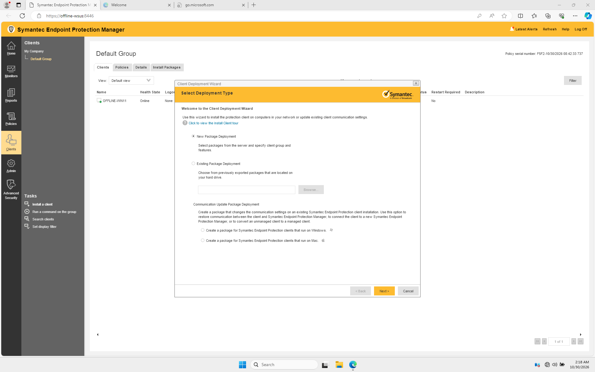
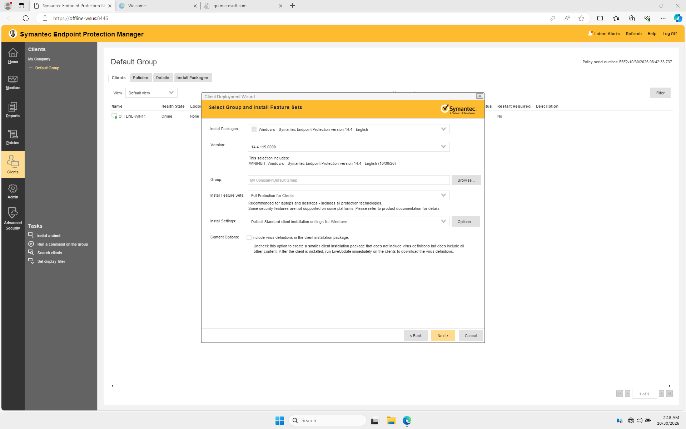
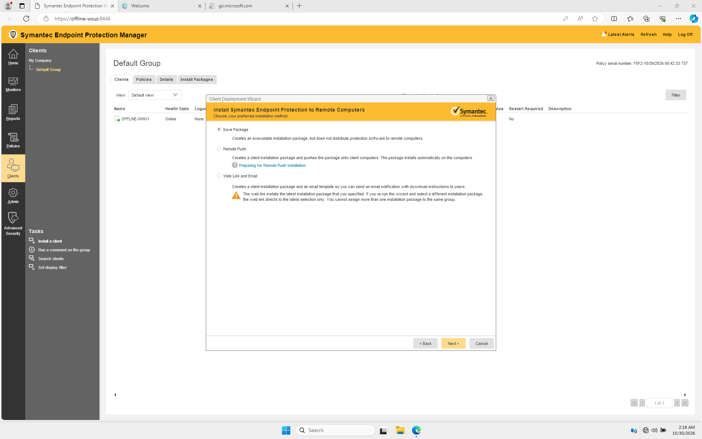
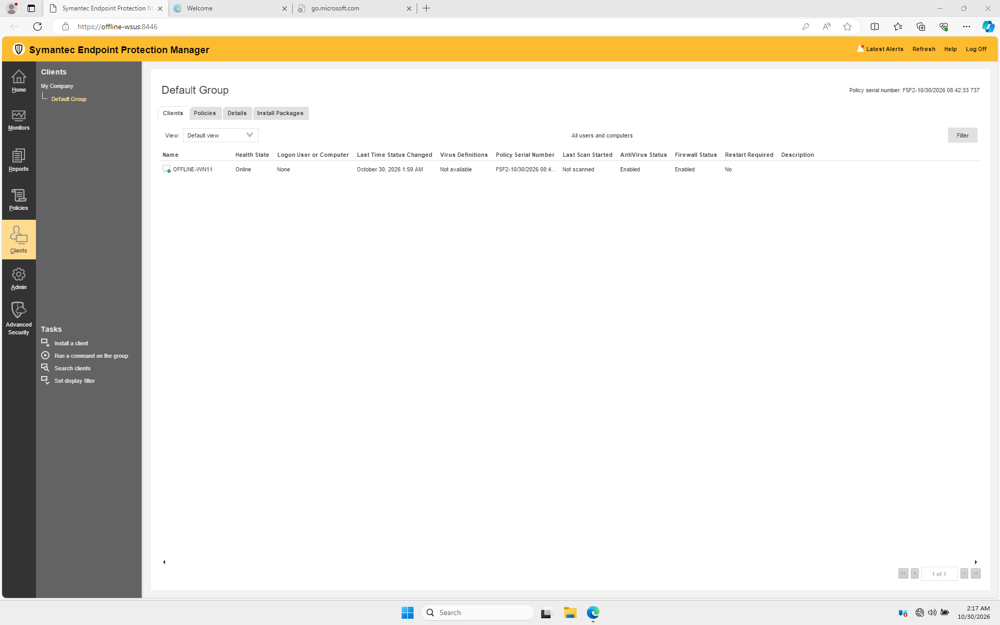

# Deploy a managed client

The manager creates a package containing the client and the communication settings for the selected group. The following is the path tested with one 64-bit Windows 11 VM.

## Export a package


1. Sign in to the SEPM console. Open **Clients**, select **Default Group**, and choose **Install a client**. Alternatively, use **Install the client software on your computers** on the Getting Started screen.

2. In the Client Deployment Wizard, choose **New Package Deployment** and continue.

    <figure markdown="span">
      { loading=lazy }
      <figcaption>Choose New Package Deployment and select Next.</figcaption>
    </figure>


3. Select the 64-bit Windows package and the intended group. In the lab the manager supplied client version **14.4.115.0000**, and **Full Protection for Clients** was selected.

    <figure markdown="span">
      { loading=lazy }
      <figcaption>Check the package version, target group, feature set and installation settings before continuing.</figcaption>
    </figure>


4. Review installation settings and restart behavior for your environment. The lab used the default standard settings. A fully silent package is a separate setting you configure before export; see [Broadcom's silent installation instructions](https://knowledge.broadcom.com/external/article/178522/silent-symantec-endpoint-protection-inst.html).

5. Select **Save Package**, then the single `.exe` package option. Continue to create and download the package. In the web console the download was a ZIP containing `setup.exe`.

    <figure markdown="span">
      { loading=lazy }
      <figcaption>Save Package creates an installer that you can carry to the client.</figcaption>
    </figure>

    <figure markdown="span">
      { loading=lazy }
      <figcaption>Choose Single .exe file. The web console downloads it inside a ZIP.</figcaption>
    </figure>

6. If the manager has no definitions yet, the wizard can warn that the package has no content. In the lab we acknowledged that warning, installed the client, and supplied antivirus definitions later through SEPM. Until content arrives, the client is not evidence of current antivirus protection.

!!! note "Package confidentiality and signatures"

    Treat the exported managed package as internal configuration material. Broadcom notes that [SEPM-exported `setup.exe` packages are not signed](https://knowledge.broadcom.com/external/article/157150); that is distinct from the signed manager installer. Verify the package came from your own manager and compare a transfer hash before running it.

## Transfer and install


1. Copy the exported ZIP to the offline client using your approved internal transfer method. In the Hyper-V lab, the host copied the file between the guests through management sessions. A physical deployment can use approved removable media or an internal share.

2. Compare the SHA-256 hash on both sides of the transfer. From PowerShell, replace the example path with the actual ZIP path:

    ```powershell
    Get-FileHash -Algorithm SHA256 -LiteralPath 'E:\Transfer\managed-client.zip'
    ```

    Matching hashes show the transferred files match each other; they do not independently prove the original package is authentic.

3. Extract the ZIP and run its `setup.exe` as an administrator. Follow the selected install settings and any restart instruction. The lab installation returned exit code `0`; an installer exit code alone does not prove the client has registered or that every protection feature is healthy.

4. Allow the client to contact the manager. In the console, go to **Clients → Default Group**, refresh, and look for the client. The lab client appeared **Online**, with antivirus and firewall shown as enabled.

    <figure markdown="span">
      { loading=lazy }
      <figcaption>The client is online. At this point in the lab the definitions had not yet been imported.</figcaption>
    </figure>

5. Check the client's definitions and policy status using [Verify and troubleshoot](verification.md). If you need to supply content offline, continue with [Update definitions offline](updates.md).
