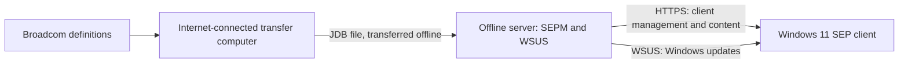

# Offline Symantec Endpoint Protection

Install Symantec Endpoint Protection Manager (SEPM) on an isolated Windows Server, connect a Windows client, and transfer antivirus definitions from an internet-connected computer. This guide records a small Hyper-V lab in which SEPM and WSUS share the same server.
{ .lead }

Lab tested 30 Oct 2026 SEPM 14.4 Windows Server 2025 Windows 11

!!! note "Public examples"

    Names, IP addresses, account details and paths in the examples are placeholders. Substitute your own values. Do not publish passwords, exported client packages, certificates or `sylink.xml` files: a managed package contains your site's communication settings.

## How the lab is arranged

The lab used an internal Hyper-V switch shared by the host and the two offline VMs. Neither guest had a default gateway. The host copied files to the guests through Hyper-V management; on a physically isolated network, use your organization's approved removable-media process instead. An internal switch and an absent default gateway do not by themselves prove a production air gap: assess all host, routing and management paths.

WSUS handles Windows updates; SEPM manages the Symantec client and distributes Symantec content. They have separate databases and update workflows.

## What was tested

| Item | Result in this lab |
| --- | --- |
| Manager | SEPM **14.4.387.0000** configured on Windows Server 2025 with SQL Server Express. Manager services and the existing WSUS service were running. |
| Client | A **14.4.115.0000** managed Windows client package installed with exit code `0`. The client appeared **Online** in the manager's Default Group. |
| Communication | The client reached the manager on TCP **443**; its connection status reported online with zero communication error codes. TCP **8530** for WSUS was reachable after installation. |
| Offline antivirus content | A certified Core 3 SDS `.jdb` file was copied into the manager's inbox. The manager processed revision `261029021`, and the client received `20261029.021` after a forced heartbeat. |
| License | The console showed a trial license. A valid production entitlement and activation process must be arranged separately. |

The test did **not** verify malware detection, a full scan, an actual WSUS update installation after adding SEP, disaster recovery, or the full range of offline security content. TCP reachability is not proof that a Windows update can be installed. Test those items separately in your environment.

!!! warning "Antivirus definitions are one content type"

    We transferred only file-based antivirus definitions. IPS, SONAR and other content were not validated. Broadcom states that some content, including Download Protection content, is not available as a `.jdb`, so an isolated client can remain marked out of date even after an antivirus update. See [Update definitions offline](updates.md#limits-of-the-jdb-method).

## Follow the guide

1. [Install and configure the manager](manager.md).
2. [Export and install a managed client](client.md).
3. [Transfer certified definitions offline](updates.md).
4. [Verify the result and troubleshoot](verification.md).

For Windows updates, use the separate [Offline WSUS runbook](../offline-wsus/index.md). The SEPM procedure does not replace WSUS metadata export, import or approvals.
