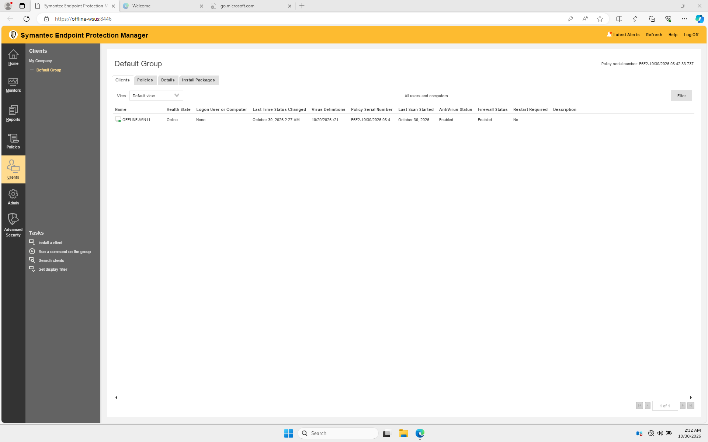

# Install and configure the manager

This procedure describes the choices made in the lab. Check [Broadcom's release and system requirements](https://knowledge.broadcom.com/external/article/154575/release-versions-notes-new-fixes-and-sys.html) for your exact manager build, operating system, database, storage and license before building another system.

## Before installation

1. Obtain the appropriate manager installation package and client package through an authorized Broadcom account or your organization's approved repository. Keep its license entitlement information with your internal records.

2. On the isolated server, verify the chosen installation drive has sufficient space for the manager, database and future content. The lab used a separate 100 GB data volume. Leave space on the system drive for prerequisites and operations too; this is a lab observation, not a sizing recommendation.

3. Confirm name resolution between the server and client, record the server's fixed address, and verify the isolation controls and any firewall rules. Plan a backup or VM checkpoint and recovery procedure before changing an existing WSUS server.

4. Verify the installer's publisher signature and compare its hash with a trusted Broadcom value when available. In the lab, both the manager `Setup.exe` and MSI showed a valid Symantec signature. That did not verify every file in the archive.

!!! warning "Sharing the WSUS server"

    Co-hosting was a lab choice, not a general production recommendation. SEPM, its SQL database, WSUS and Windows all need CPU, memory and disk resources. Broadcom [recommends a server without a critical role](https://knowledge.broadcom.com/external/article/177535/best-practices-for-symantec-endpoint-pro.html). Check supportability, sizing, port use and recovery together before combining roles in production.

## Install and run the configuration wizard

!!! note "About these screenshots"

    The original 14.4 installation was not captured. The wizard examples below are from **SEPM 14 MP1**, unless otherwise stated. They illustrate similar screens but are not recordings of this lab. Screen text and options can differ in 14.4. In particular, 14 MP1 used an embedded database; the lab's 14.4 default configuration installed SQL Server Express. Images hosted by the source require internet access.

### 1. Open the installer

On the server, extract the approved installation package, right-click the manager `Setup.exe`, and select **Run as administrator**. Choose **Install Symantec Endpoint Protection Manager**. On the first wizard screen, select **Next**.

*Example: select Next to start the manager installation. [Source: Broadcom community walkthrough by IN007](https://community.broadcom.com/symantecenterprise/viewdocument/how-to-install-sepm-14-mp1-with-emb?CommunityKey=1ecf5f55-9545-44d6-b0f4-4e4a7f5f5e68&tab=librarydocuments).*

### 2. Accept the license

Read the license terms. If you accept them, choose **I accept the terms in the license agreement**, then select **Next**.

*Example: accept the license terms before continuing. [Source: Broadcom community walkthrough by IN007](https://community.broadcom.com/symantecenterprise/viewdocument/how-to-install-sepm-14-mp1-with-emb?CommunityKey=1ecf5f55-9545-44d6-b0f4-4e4a7f5f5e68&tab=librarydocuments).*

### 3. Choose the installation folder

Accept the suggested location or select **Browse** to choose another drive. The lab used `D:\Symantec\SEPM` on a separate 100 GB volume. Confirm free space for the manager and its content, then select **Next**. Use current Broadcom requirements for your version; the resource figures in this older image are historical.

*Example: choose a destination; the path and sizing shown are from the older example, not this lab. [Source: Broadcom community walkthrough by IN007](https://community.broadcom.com/symantecenterprise/viewdocument/how-to-install-sepm-14-mp1-with-emb?CommunityKey=1ecf5f55-9545-44d6-b0f4-4e4a7f5f5e68&tab=librarydocuments).*

### 4. Install the manager files

On **Ready to Install**, select **Install**. Wait for the files to be installed.

*Example: select Install when the destination and prerequisites are correct. [Source: Broadcom community walkthrough by IN007](https://community.broadcom.com/symantecenterprise/viewdocument/how-to-install-sepm-14-mp1-with-emb?CommunityKey=1ecf5f55-9545-44d6-b0f4-4e4a7f5f5e68&tab=librarydocuments).*

When the installation summary reports success, select **Next** to start the Management Server Configuration Wizard.

*Example: select Next to begin server configuration. [Source: Broadcom community walkthrough by IN007](https://community.broadcom.com/symantecenterprise/viewdocument/how-to-install-sepm-14-mp1-with-emb?CommunityKey=1ecf5f55-9545-44d6-b0f4-4e4a7f5f5e68&tab=librarydocuments).*

### 5. Choose the configuration type

Choose **Default configuration for new installation (fewer than 500 clients)** and select **Next**. In the lab, the 14.4 wizard installed a separate SQL Server Express instance automatically. Custom and recovery configurations serve different deployment scenarios.

*Example: choose Default configuration for a small, new installation. The embedded database text in this older image does not apply to the 14.4 lab. [Source: Broadcom community walkthrough by IN007](https://community.broadcom.com/symantecenterprise/viewdocument/how-to-install-sepm-14-mp1-with-emb?CommunityKey=1ecf5f55-9545-44d6-b0f4-4e4a7f5f5e68&tab=librarydocuments).*

### 6. Create the manager administrator

Enter the company name, administrator password and email address. The lab used the default `admin` name and a non-deliverable placeholder email. Store the password securely: the wizard notes that the initial password is also used for the database, and a later administrator password change does not automatically change the database password.

To receive notifications and password reset messages, configure a reachable email server and verify delivery. The lab did not configure SMTP and could not receive these emails. Complete the fields and select **Next**; if prompted about skipping email server configuration, follow your environment's recovery requirements.

*Broadcom's administrator account example for a newer release. Source: [Broadcom's SEPM installation guide](https://knowledge.broadcom.com/external/article/165074).*

### 7. Set the default client password

On **Default Client Password**, enter and confirm a strong password, record it securely, and select **Next**. This password protects actions such as stopping or uninstalling the client. Starting in 14.3 RU10, this is a separate required screen; the older screenshots do not show it. See [Broadcom's RU10 release announcement](https://support.broadcom.com/web/ecx/support-content-notification/-/external/content/release-announcements/0/25375).

### 8. Partner information and data collection

Leave **Partner Information** blank if it does not apply, then continue. The lab disabled optional server data collection. Your screens may show these choices separately.

*Example: partner information is optional. Ignore the LiveUpdate checkbox in this older image; later versions behave differently. [Source: Broadcom community walkthrough by IN007](https://community.broadcom.com/symantecenterprise/viewdocument/how-to-install-sepm-14-mp1-with-emb?CommunityKey=1ecf5f55-9545-44d6-b0f4-4e4a7f5f5e68&tab=librarydocuments).*

*Example: the data collection screen and database progress. This older example has data collection checked; the lab disabled it. [Source: Broadcom community walkthrough by IN007](https://community.broadcom.com/symantecenterprise/viewdocument/how-to-install-sepm-14-mp1-with-emb?CommunityKey=1ecf5f55-9545-44d6-b0f4-4e4a7f5f5e68&tab=librarydocuments).*

### 9. Wait for database setup

Allow the wizard to install SQL Server Express and initialize the database. If an SQL Express prerequisite prompt appears, read it and resolve missing Windows updates as appropriate before continuing. Database setup can take several minutes. For failures, consult [Broadcom's SQL Express installation troubleshooting](https://knowledge.broadcom.com/external/article/203775).

### 10. Finish and open the console

When **Configuration completed** appears, select **Finish**. Open the console and sign in with the manager administrator account. In this lab the web console used HTTPS port **8446**; use your own configured URL and certificate.

*Example: the configuration has finished; select Finish. [Source: Broadcom community walkthrough by IN007](https://community.broadcom.com/symantecenterprise/viewdocument/how-to-install-sepm-14-mp1-with-emb?CommunityKey=1ecf5f55-9545-44d6-b0f4-4e4a7f5f5e68&tab=librarydocuments).*

*The lab console after the client was installed and definitions were imported. Those actions come later in the guide.*

!!! tip "Check before proceeding"

    Confirm that the manager and its SQL Express service are running, the console opens, and WSUS still starts. The manager installation alone does not install the SEP protection client on the server. Continue with [client deployment](client.md).

## Record internally

Keep the manager build, license expiry, server name and address, installation and database paths, management ports, administrator recovery method, service account details and backup location in a protected operations record. Do not reuse the lab's placeholder email or test passwords in production.
