# One-time build

This section builds everything once. Each step uses the mouse wherever Windows has a screen for it. Where only a command works, or a command is clearly easier, the step says so and gives the command.

!!! note "How to read the screenshots"

    Red boxes with numbers show what to click. The number in the step text matches the number on the picture, for example <span class="mk">1</span>. All server screens come from our lab server named OFFLINE-WSUS. The online server shows the same console.

    <span class="tag gui">GUI</span> means you do it with the mouse. <span class="tag cli">CLI</span> means you type a command in PowerShell, run as administrator.

## What needs the command line

| Task | Method | Why |
| --- | --- | --- |
| Install the WSUS role and choose options | <span class="tag gui">GUI</span> | Server Manager and the WSUS console cover it. |
| Sync, find, approve, decline an update | <span class="tag gui">GUI</span> | All in the WSUS console. |
| Cleanup wizard | <span class="tag gui">GUI</span> | WSUS console, Options. |
| Take or restore a checkpoint | <span class="tag gui">GUI</span> | Hyper-V Manager. |
| Restart BITS or WSUS service | <span class="tag gui">GUI</span> | Services console. |
| Client WSUS policy | <span class="tag gui">GUI</span> | Group Policy editor. A registry command is the quick alternative. |
| Install on the client, check the build | <span class="tag gui">GUI</span> | Settings and `winver`. |
| Foreground download setting | <span class="tag cli">CLI</span> | No screen for it in Windows. |
| Check download size and which files are new | <span class="tag cli">CLI</span> | The console lists files but does not add them up or compare with disk. |
| Hash check of every file | <span class="tag cli">CLI</span> | No screen for it. |
| Export and import the catalog | <span class="tag cli">CLI</span> | `wsusutil` has no screen. |
| Carry only the new files | <span class="tag cli">CLI</span> or File Explorer | Explorer copy works if you pick files from the list the script prints. |
| Trim hundreds of old updates, reindex the database | <span class="tag cli">CLI</span> | Selecting hundreds of rows by hand is slow, and indexing has no screen. |

## 4.1 Isolated network (lab)

<span class="tag gui">GUI</span> In Hyper-V Manager, click **Virtual Switch Manager…** in the Actions pane (top right, see the screenshot in [Monthly routine](monthly-routine.md), step 4). Choose **Internal**, click **Create Virtual Switch**, and name it `OfflineNet`. Do not create a NAT. Give the offline servers static addresses on `10.0.0.0/24` and no default gateway.

<span class="tag cli">CLI</span> The same thing in one block, plus the address on the host side:

```powershell title="powershell on the Hyper-V host"
New-VMSwitch -Name OfflineNet -SwitchType Internal
New-NetIPAddress -InterfaceAlias "vEthernet (OfflineNet)" -IPAddress 10.0.0.1 -PrefixLength 24
# No New-NetNat on purpose.

# Prove the isolation from the offline server (all should fail):
# Test-NetConnection 192.0.2.2 -Port 22      (the online server)
# Get-NetRoute -DestinationPrefix 0.0.0.0/0      (should return nothing)
```

!!! warning "Check"

    A Windows 11 Hyper-V host can forward packets between adapters if routing is on. Run `Get-NetIPInterface | Select InterfaceAlias,Forwarding` and make sure forwarding is `Disabled`.

## 4.2 Install the WSUS role

<span class="tag gui">GUI</span> Do this on both servers. These first screens are the ones we captured.

1. **Open Server Manager**

    Click the Start button, then <span class="mk">1</span> **Server Manager**. On Windows Server it also starts by itself after sign-in.

    <figure markdown="span">
      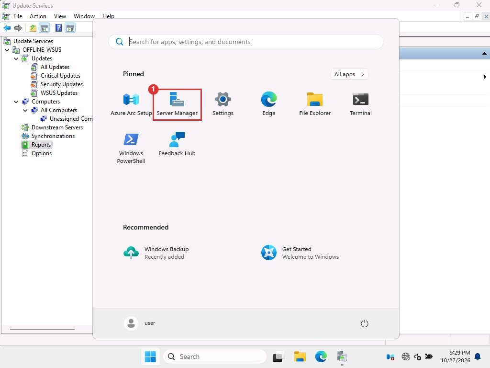{ loading=lazy }
      <figcaption>Start menu. Server Manager is pinned.</figcaption>
    </figure>

2. **Start the Add Roles wizard**

    In Server Manager click <span class="mk">1</span> **Manage**, then <span class="mk">2</span> **Add Roles and Features**. On the first pages click **Next**, choose **Role-based or feature-based installation**, and pick your server from the list.

    <figure markdown="span">
      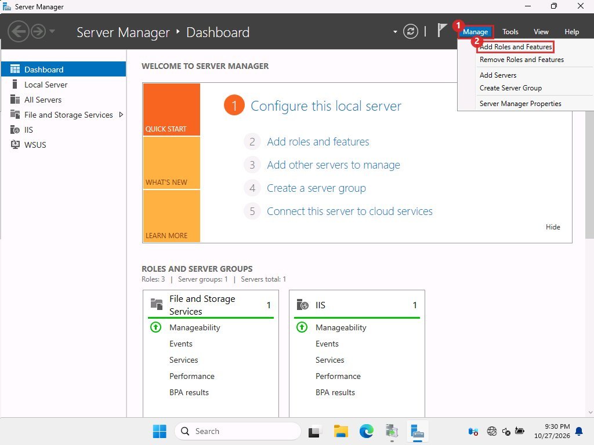{ loading=lazy }
      <figcaption>Manage menu.</figcaption>
    </figure>

3. **Tick the WSUS role**

    On *Select server roles*, tick <span class="mk">1</span> **Windows Server Update Services**. A box asks to add required features, so click **Add Features**. Then <span class="mk">2</span> **Next**.

    <figure markdown="span">
      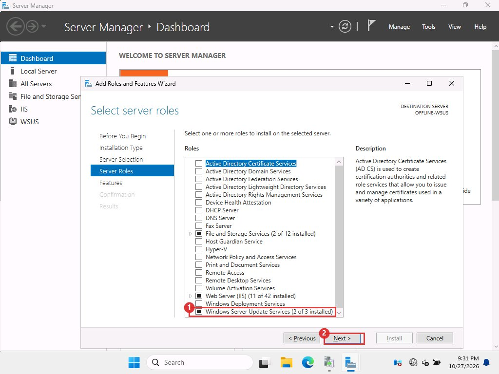{ loading=lazy }
      <figcaption>Our server already had WSUS, so its row reads &quot;2 of 3 installed&quot;. On a new server it is an unticked box.</figcaption>
    </figure>

4. **Finish the wizard**

    We did not capture the remaining pages because the role was already installed. They are the standard ones:

    - *Features*: keep the defaults, **Next**.
    - *Windows Server Update Services* info page: **Next**.
    - *Role Services*: keep **WID Connectivity** and **WSUS Services** ticked, and leave **SQL Server Connectivity** unticked. This gives the local Windows Internal Database.
    - *Content location*: tick **Store updates in the following location** and type the folder, for example `C:\WSUS`.
    - Web Server (IIS) pages: **Next** through them. Then **Install**.

    When it finishes, a yellow flag appears in Server Manager. Click it, then **Launch Post-Installation tasks**. This runs `wsusutil postinstall` for you.

5. **Skip the first-run wizard on the offline server**

    The first time you open the WSUS console it may offer a *WSUS Configuration Wizard*. On the offline server click **Cancel**. Its connect step needs the internet. You set the same options by hand in 4.4. On the online server you can use it, or the same Options screens.

<span class="tag cli">CLI</span> If you prefer commands:

```powershell title="powershell on each server"
Install-WindowsFeature -Name UpdateServices -IncludeManagementTools
& "$env:ProgramFiles\Update Services\Tools\wsusutil.exe" postinstall CONTENT_DIR=C:\WSUS
```

!!! note "Content folder"

    Our online server used `C:\WsusContent` and the offline server used `C:\WSUS\WsusContent`. Read the real path from the registry in scripts: `(Get-ItemProperty 'HKLM:\SOFTWARE\Microsoft\Update Services\Server\Setup').ContentDir`, then add `\WsusContent`.

## 4.3 Open the WSUS console

<span class="tag gui">GUI</span> In Server Manager click <span class="mk">1</span> **Tools**, then <span class="mk">3</span> **Windows Server Update Services**. The same menu has <span class="mk">2</span> **Services**, which you need later to restart BITS.

<figure markdown="span">
  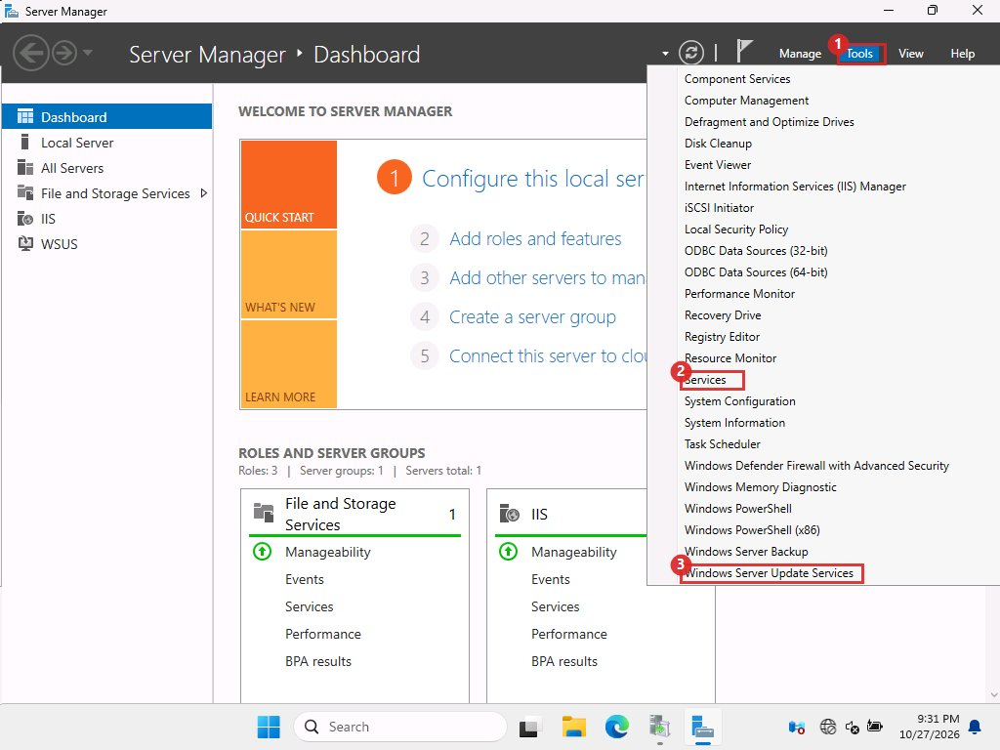{ loading=lazy }
  <figcaption>Tools menu in Server Manager.</figcaption>
</figure>

The window is called *Update Services*. The left tree has **Updates**, **Computers**, **Synchronizations**, **Reports** and **Options**. Everything below happens here.

## 4.4 Set the options

<span class="tag gui">GUI</span> In the left tree click **Options**. The page lists the settings. Open each one in turn, make the change, click **OK**.

<figure markdown="span">
  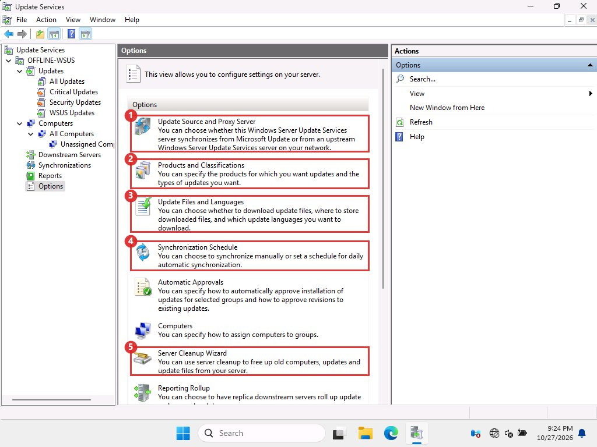{ loading=lazy }
  <figcaption>Options page. Boxes 1 to 5 are the five screens below, in order.</figcaption>
</figure>

### Update Source and Proxy Server <span class="mk">1</span>

Leave <span class="mk">1</span> **Synchronize from Microsoft Update** selected. This is the default on both servers. On the offline server it stays selected too, because you never click Synchronize there. Click <span class="mk">2</span> **OK**.

<figure markdown="span">
  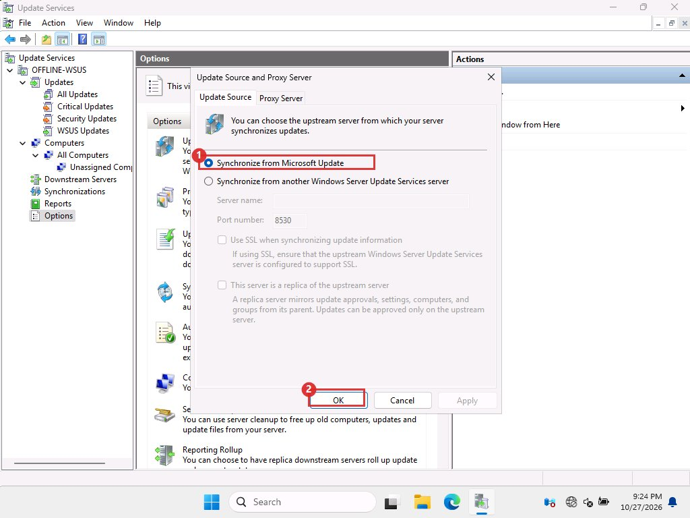{ loading=lazy }
  <figcaption>Update Source tab. A proxy, if you need one, goes on the Proxy Server tab.</figcaption>
</figure>

### Products and Classifications <span class="mk">2</span> (online server only)

Choose what the online server downloads metadata for. Under <span class="mk">1</span> **Products** untick **All Products**, then tick only **Windows 11** (it is under *Microsoft* and then *Windows*). Under <span class="mk">2</span> **Classifications** tick **Security Updates**, and **Update Rollups** if you want the .NET updates. Click **OK**.

<figure markdown="span">
  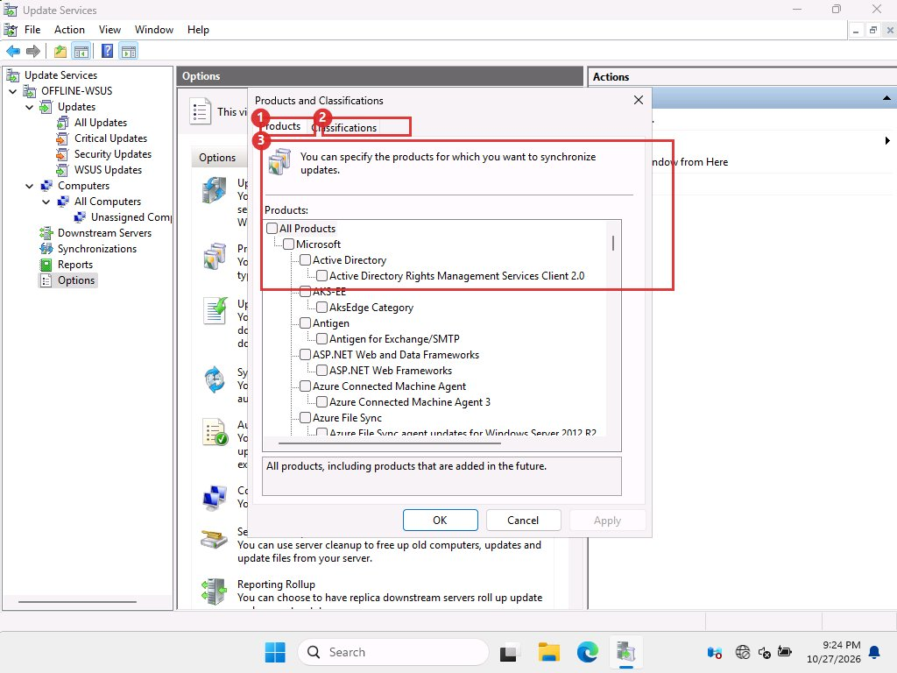{ loading=lazy }
  <figcaption>Products tab (box 3 is the product list) and Classifications tab.</figcaption>
</figure>

The offline server learns its products from the imported catalog, so you do not set this there.

### Update Files and Languages <span class="mk">3</span>

On <span class="mk">1</span> **Update Files**: select <span class="mk">2</span> **Store update files locally on this server**, tick <span class="mk">3</span> **Download update files to this server only when updates are approved**, and leave <span class="mk">4</span> **Download express installation files** unticked. The two servers must match on this box. Then open the **Update Languages** tab and keep English only on both servers.

<figure markdown="span">
  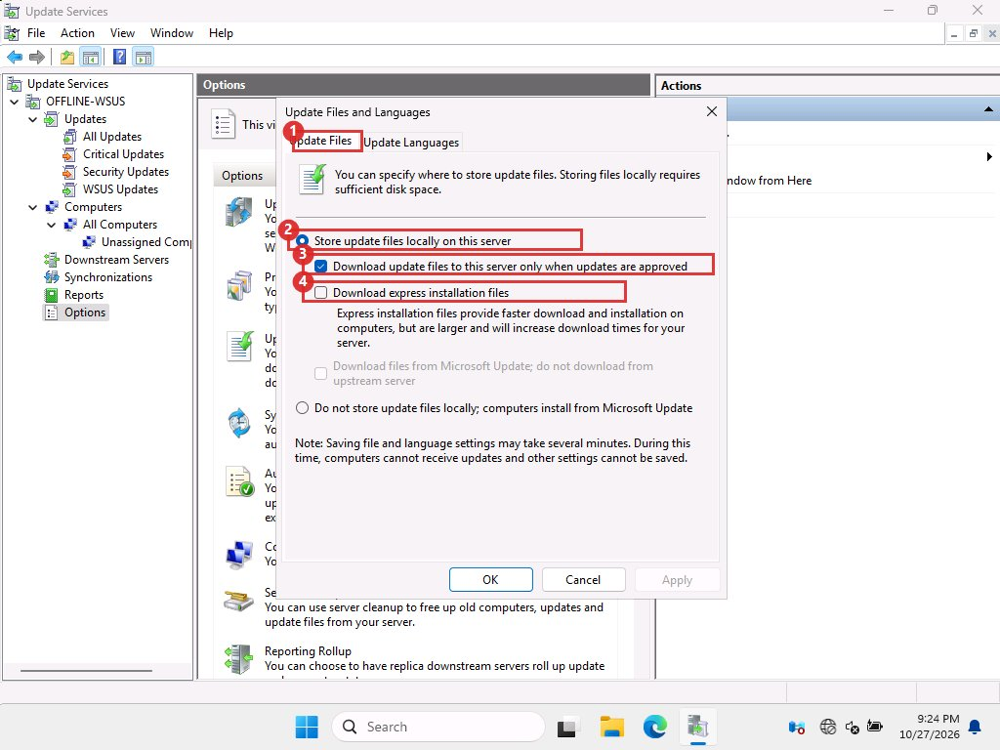{ loading=lazy }
  <figcaption>Update Files tab.</figcaption>
</figure>

!!! note "Why only when approved"

    With this setting a declined or unapproved update never downloads its files. That is why cleanup of old updates freed no disk space in our lab.

### Synchronization Schedule <span class="mk">4</span>

Select <span class="mk">1</span> **Synchronize manually** on both servers and click **OK**. You decide when a sync happens.

<figure markdown="span">
  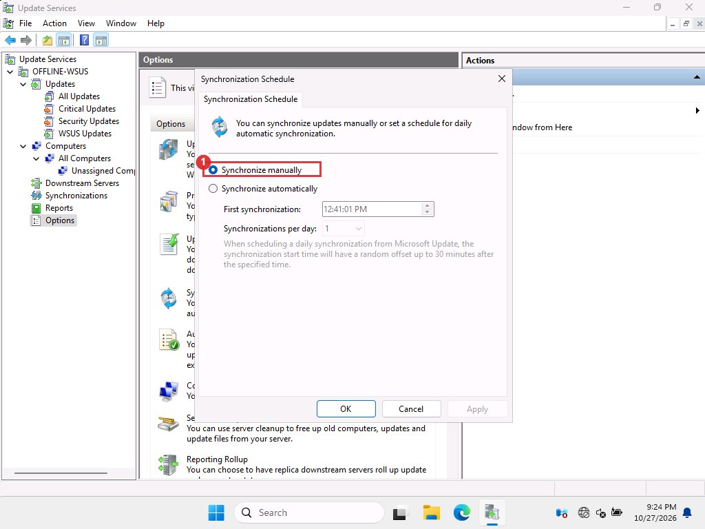{ loading=lazy }
  <figcaption>Manual sync selected.</figcaption>
</figure>

## 4.5 Turn on foreground downloads (online server)

<span class="tag cli">CLI</span> There is no screen for this setting. It fixed stuck downloads in our lab, see [Fixing problems](troubleshooting.md).

```powershell title="powershell on the online server"
$c = (Get-WsusServer).GetConfiguration()
$c.BitsDownloadPriorityForeground = $true
$c.Save()
Restart-Service WsusService -Force
```

## 4.6 Point the client at the offline server

<span class="tag gui">GUI</span> This is the Group Policy editor on the client. On a domain, edit a Group Policy Object instead. The path is the same.

1. **Open the editor**

    Press <kbd>Windows</kbd> + <kbd>R</kbd>, type `gpedit.msc`, press <kbd>Enter</kbd>.

2. **Go to the WSUS settings**

    Open **Computer Configuration**, **Administrative Templates**, **Windows Components**, **Windows Update**, then **Manage updates offered from Windows Server Update Service**. Double-click <span class="mk">1</span> **Specify intranet Microsoft update service location**.

    <figure markdown="span">
      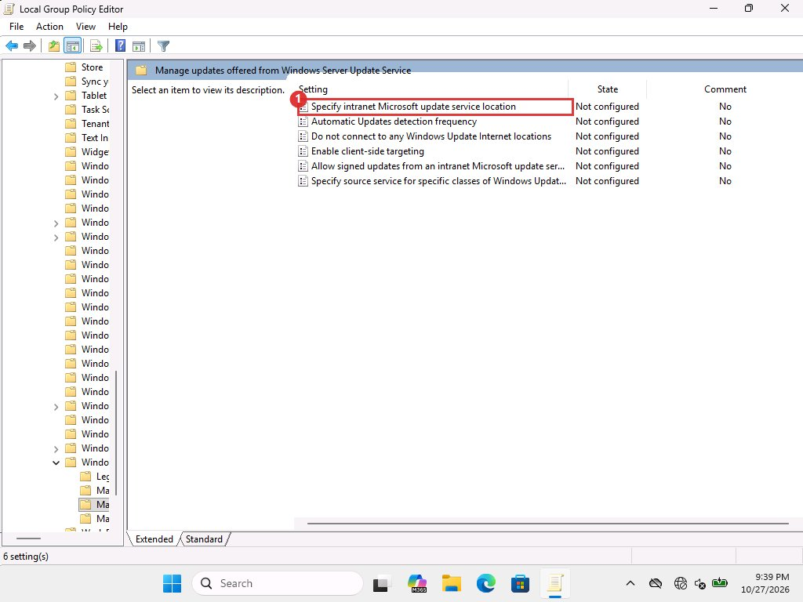{ loading=lazy }
      <figcaption>The six WSUS policies. All are &quot;Not configured&quot; until you set them.</figcaption>
    </figure>

3. **Enter the server address**

    Select <span class="mk">1</span> **Enabled**. In <span class="mk">2</span> **Set the intranet update service for detecting updates** type the offline WSUS address, for example `http://10.0.0.10:8530`. Type the same address in *Set the intranet statistics server* below it. Click <span class="mk">3</span> **OK**.

    <figure markdown="span">
      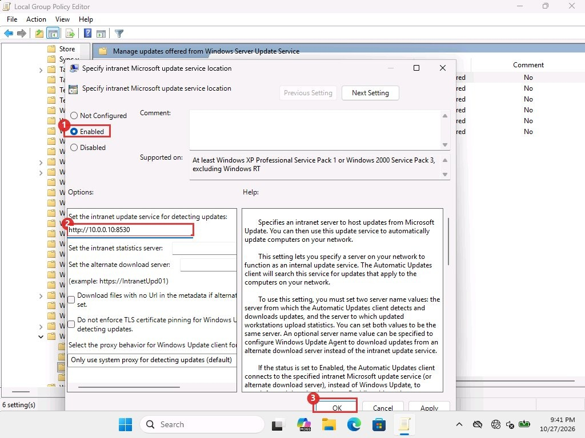{ loading=lazy }
      <figcaption>We only filled the first box for the picture and then cancelled. Fill both boxes and press OK.</figcaption>
    </figure>

4. **Block the internet source**

    Back in the list, open **Do not connect to any Windows Update Internet locations**, select **Enabled**, click **OK**. Then run `gpupdate /force`, or restart the client.

!!! note "How you know it worked"

    In Settings, Windows Update, the line "Get the latest updates as soon as they're available" turns grey with the text "This setting isn't available due to your organisation's policy". The finished-state screenshot in [Installing on the client](client-install.md) shows it.

<span class="tag cli">CLI</span> Our lab set the same values straight in the registry. This is faster for many machines but is not the same as Group Policy: the editor then still shows "Not configured" (we saw that), so use one method and stay with it.

```powershell title="powershell on the client, as administrator"
$k = 'HKLM:\SOFTWARE\Policies\Microsoft\Windows\WindowsUpdate'
New-Item $k -Force | Out-Null
Set-ItemProperty $k WUServer       'http://10.0.0.10:8530'
Set-ItemProperty $k WUStatusServer 'http://10.0.0.10:8530'
Set-ItemProperty $k DoNotConnectToWindowsUpdateInternetLocations 1 -Type DWord
New-Item "$k\AU" -Force | Out-Null
Set-ItemProperty "$k\AU" UseWUServer 1 -Type DWord
```

The client must be able to reach port 8530 on the offline server.
