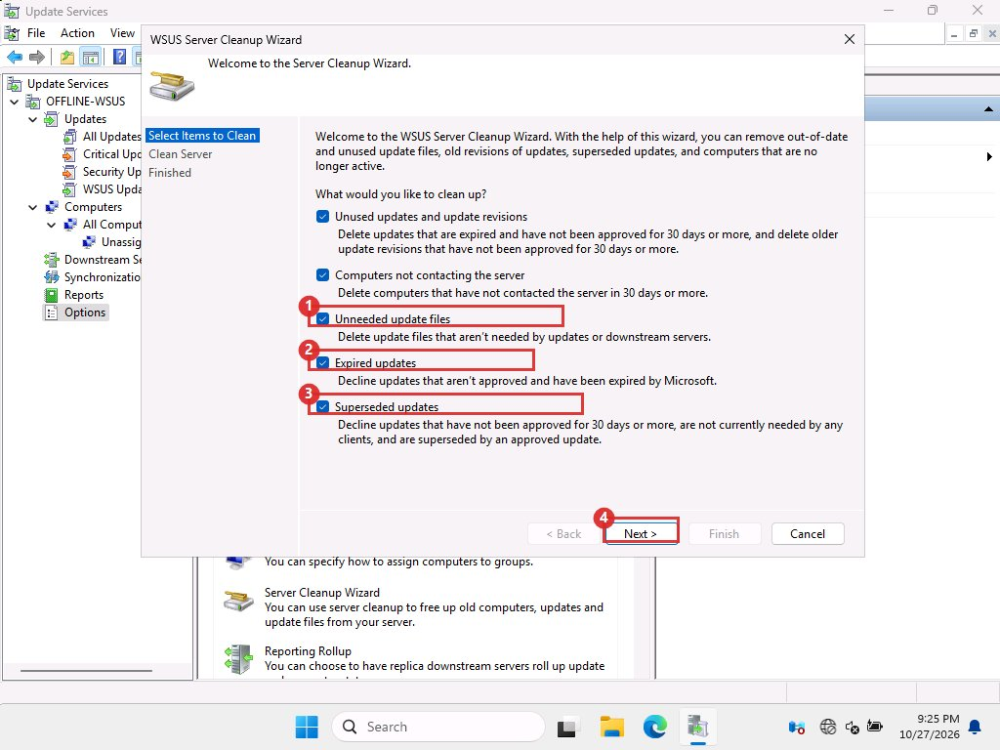

# Cleanup and retention

Without cleanup the catalog keeps growing, the console slows down, and old updates clutter every view. We settled on a rolling window of 12 months of Windows 11 updates.

## What each action does

| Action | Effect | Frees disk? |
| --- | --- | --- |
| Decline an update | Hides it from the default console view. Metadata stays in the database. | No |
| Delete a declined update | Removes its record from the database. Permanent without a restore. | No (declined updates had no files) |
| Server Cleanup Wizard, "Unneeded update files" | Deletes content files no active update needs. | Yes |
| Reindex SUSDB | Rebuilds indexes and statistics so the database stays fast. | No |

## Decline old updates GUI

1. **Take a checkpoint or backup first**

    See [Monthly routine](monthly-routine.md), step 4. Make sure automatic sync is off.

2. **List what you could decline**

    Click **Updates**, **All Updates**. Set **Approval** to **Any Except Declined**, then click **Refresh**. Click the **Release Date** column header to sort by date.

3. **Select the old rows and decline them**

    Click the oldest row, hold <kbd>Shift</kbd>, click the last row that is older than 12 months. Click **Decline** in the Actions pane, or right-click and choose **Decline**. Confirm if asked. Do not select approved updates.

    The console is slow with hundreds of rows. For a first trim use script 8 instead.

## Delete declined updates and reindex CLI

There is no screen for deleting declined records or for reindexing. Script 8 does the decline, the delete and the reindex together, as the Microsoft maintenance article describes. Run it on the offline server first, then the online server.

## Free disk space GUI

Disk is freed by removing old months' files. When a month falls out of use, decline its cumulative update, then run the cleanup wizard. Its unique files (about 5 GB) go. The shared base files stay while later months need them.

1. **Open the wizard**

    Click **Options**, then 5 **Server Cleanup Wizard** (see the Options picture in 4.4).

2. **Untick two boxes**

    The wizard opens with everything ticked. **Untick 2 Expired updates and 3 Superseded updates.** Keep 1 **Unneeded update files** ticked. Then click 4 **Next**, and **Finish** when it ends. The report tells you how many GB were freed.

    <figure markdown="span">
      { loading=lazy }
      <figcaption>Cleanup wizard as it opens. Boxes 2 and 3 are ticked by default and must be unticked.</figcaption>
    </figure>

    !!! danger "Why untick Superseded"

        Every cumulative update except the newest is "superseded". With that box ticked the wizard declines any of them that you have not approved for 30 days. That removes the months you meant to keep.

!!! note "Deleted records stay deleted, until you add a product back"

    After our trim, a normal sync on the online server added nothing back: the catalog stayed at 157 updates. WSUS only sends changes since the last sync, so it does not resend what you deleted.

    The reverse is also true. When we needed the Server 2025 updates that the trim had removed, a plain sync did not return them. What worked was to untick the product, sync, tick it again and sync. That refetched the whole product, including old months: 44 Server 2025 updates came back, and 20 were more than 12 months old. Run script 8 again afterwards, then export and import the catalog.

    If you keep more than one product ticked, set the product list at the top of script 8 first. Its default rule declines anything that is not Windows 11.

!!! warning "Do not"

    - Do not clean up during a sync or an import.
    - Do not delete files from the content folder by hand.

The Microsoft guide we followed is the [WSUS database maintenance article](https://learn.microsoft.com/en-us/troubleshoot/mem/configmgr/update-management/wsus-automatic-maintenance). It also covers shrinking SUSDB, which we skipped.
