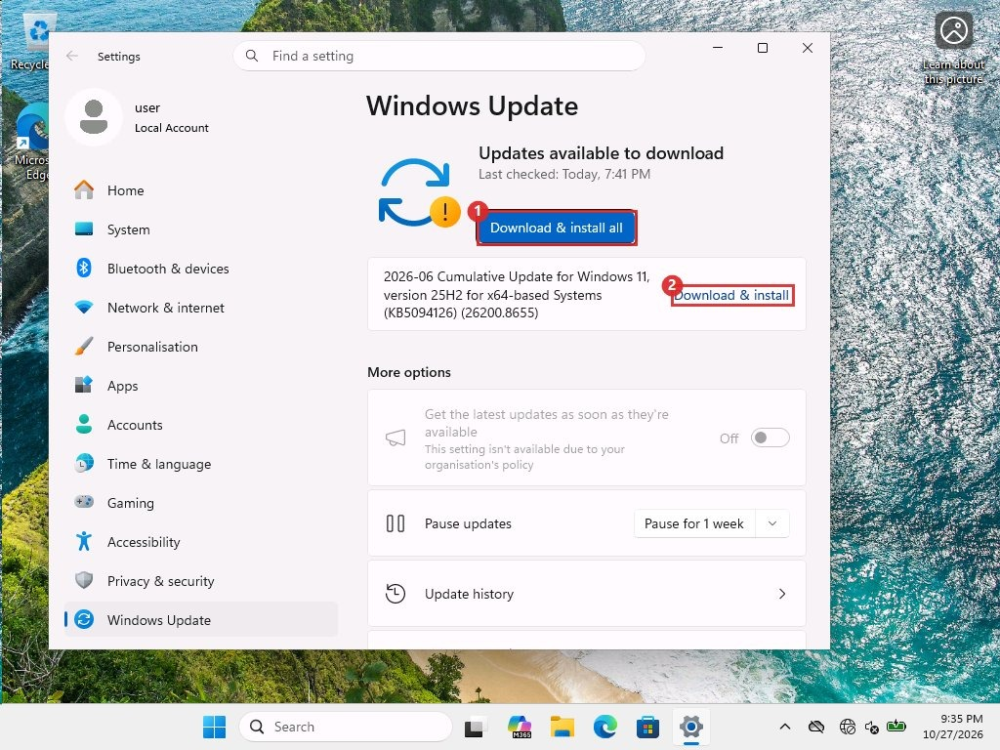
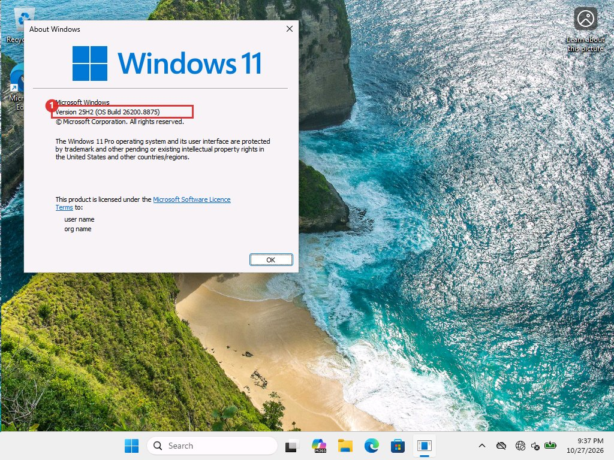
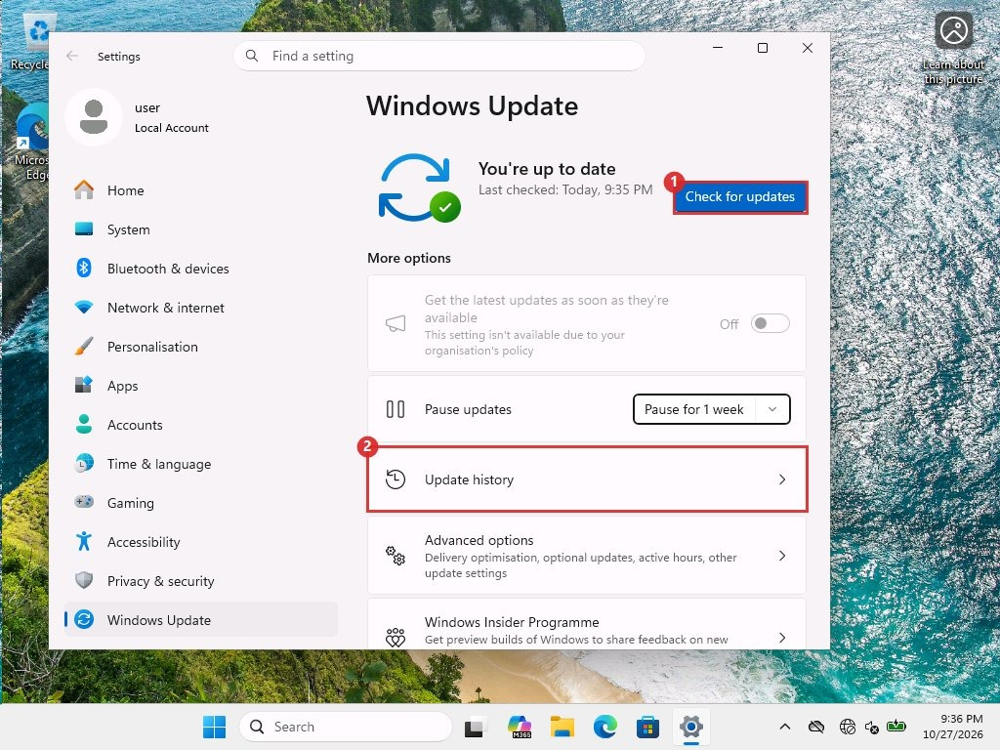
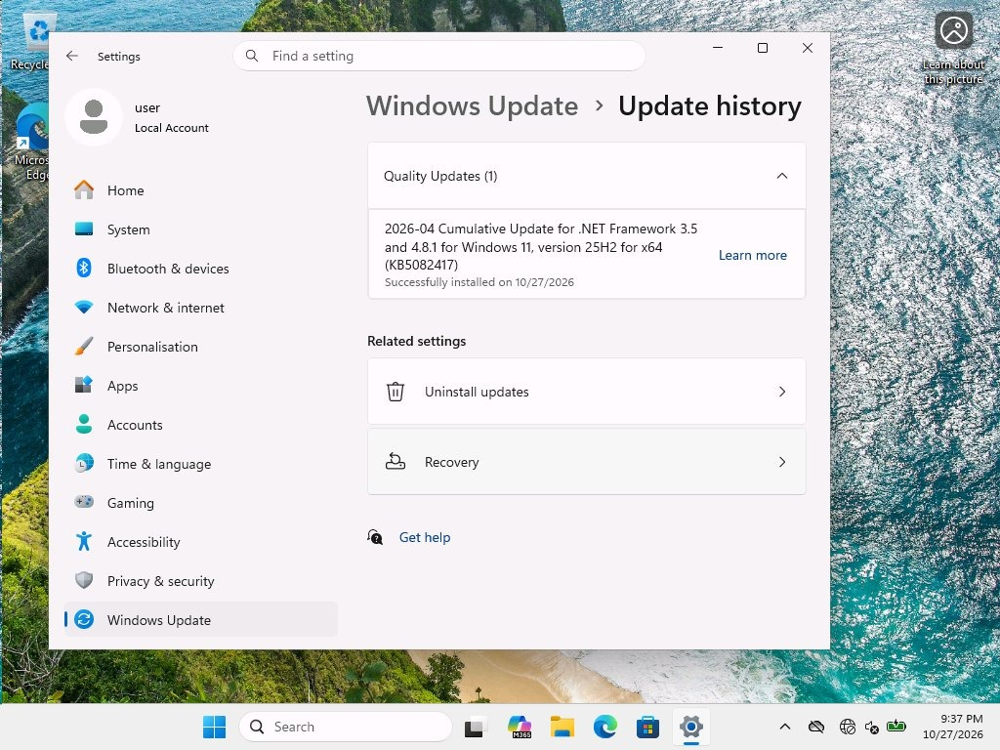

# Installing on the client

## The normal way <span class="tag gui">GUI</span>

1. **Open Windows Update**

    Click Start, then **Settings**, then **Windows Update**. Or press <kbd>Windows</kbd> + <kbd>R</kbd> and type `ms-settings:windowsupdate`.

2. **Install the offered update**

    When an update is waiting the page says "Updates available to download". Click <span class="mk">1</span> **Download & install all**, or <span class="mk">2</span> **Download & install** next to one update. Allow about 15 minutes.

    <figure markdown="span">
      { loading=lazy }
      <figcaption>Update waiting. The month shown is June because this is the lab&#x27;s own page from earlier. Yours shows the month you approved.</figcaption>
    </figure>

3. **Restart and wait**

    When it asks, click **Restart now**.

    !!! danger "Leave it alone"

        After the restart, do not sign in, open a console or run commands for about 25 minutes. Judge by the screen or the heartbeat going quiet, not just the clock. Our first April attempt rolled back after an automated sign-in during the restart. The retry, left alone, worked. The cause was never proven, but waiting costs nothing.

4. **Check the build number**

    Press <kbd>Windows</kbd> + <kbd>R</kbd>, type `winver`, press <kbd>Enter</kbd>. The box shows <span class="mk">1</span> the build. July 2026 is **26200.8875**.

    <figure markdown="span">
      { loading=lazy }
      <figcaption>About Windows. This is the most reliable check.</figcaption>
    </figure>

5. **Confirm nothing else is offered**

    Open Windows Update again. The finished state reads "You're up to date". The greyed line <span class="mk">2</span> "Get the latest updates as soon as they're available" with the organisation policy note shows the WSUS policy is active. Click <span class="mk">1</span> **Check for updates** to scan again.

    <figure markdown="span">
      { loading=lazy }
      <figcaption>Finished state. Box 2 is Update history.</figcaption>
    </figure>

!!! warning "Two things Settings got wrong in our lab"

    - **Stale offers.** After July was installed, the Settings page still listed the June update as available. A scan from Windows Update's own COM interface said there was nothing to install. Running `usoclient StartInteractiveScan` inside the signed-in session made the page show "You're up to date". The cause is unproven.
    - **Incomplete history.** The Update history page listed only the .NET update, not the cumulative updates we installed with the script. Do not use it to prove an install. Use `winver`.

<figure markdown="span">
  { loading=lazy }
  <figcaption>Update history in Settings. Only the .NET update is listed.</figcaption>
</figure>

## Before you install

- Take a checkpoint of a VM client, or have a working backup for a physical one.
- Back up the BitLocker recovery key if the client uses BitLocker. Web reports of the June and July updates mention BitLocker recovery prompts on some machines.
- Check free space on C: and how full the EFI system partition is. Our lab client had a 260 MB one. Web reports blame small EFI partitions for the June failures, but we never measured ours.

## The scripted way <span class="tag cli">CLI</span>

Use this when you want a log and a script that waits for the update to be offered, instead of clicking through Settings. Sign in on the client as an administrator and run script 10 from an elevated PowerShell window. It scans, waits until the update is offered, downloads it from the offline server, installs it, and prints and saves a log.

1. **Open PowerShell as administrator**

    Right-click the Start button and click **Terminal (Admin)** or **Windows PowerShell (Admin)**. Click **Yes** on the permission box. The window title says *Administrator*. A window that is not elevated cannot install updates.

2. **Save script 10 <span class="tag gui">GUI</span>**

    Type `mkdir C:\Temp` in the window. Click Start, type `Notepad`, right-click it and click **Run as administrator**. Paste script 10 from [Script library](scripts.md), change the KB number on the first line, click **File**, **Save as**, set *Save as type* to **All files**, and save as `C:\Temp\wu-install.ps1`.

3. **Run it**

    ```powershell title="powershell on the client, as administrator"
    powershell -NoProfile -ExecutionPolicy Bypass -File C:\Temp\wu-install.ps1
    ```

    The window prints each step as it goes, and the same lines are saved in `C:\Temp\wu-install.log`. Leave the window open until it prints `DONE`. If the update is not offered yet, the script rescans once a minute.

The same checks from the command line:

```powershell title="powershell on the client"
$cv = Get-ItemProperty 'HKLM:\SOFTWARE\Microsoft\Windows NT\CurrentVersion'
"Build: $($cv.CurrentBuildNumber).$($cv.UBR)"

(New-Object -ComObject Microsoft.Update.Session).CreateUpdateSearcher().QueryHistory(0,5) |
  ForEach-Object {
    "{0:g} code={1} hr=0x{2:X8} {3}" -f $_.Date, $_.ResultCode, $_.HResult, $_.Title
  }

$r = (New-Object -ComObject Microsoft.Update.Session).CreateUpdateSearcher().Search("IsInstalled=0 and IsHidden=0")
"Still offered: " + $r.Updates.Count
```

Success is the expected build (July 2026 is 26200.8875), a history entry with `code=2` and `hr=0x00000000`, and nothing left offered.

!!! note "If it is not offered yet"

    The first scans after approving and resetting returned 0 updates in both April and July. The update showed up after about 20 minutes. Keep rescanning before you assume something is broken. Script 10 waits and rescans once a minute.
