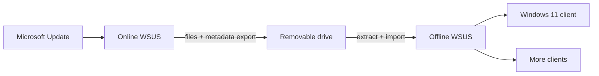

# Offline WSUS Runbook

How to patch an air-gapped Windows 11 estate through an offline WSUS server, using an internet-connected WSUS and a removable drive as the only link. Build steps, the monthly routine, cleanup, and fixes for every problem we hit while proving it. Every task that has a Windows screen is shown with the mouse and a screenshot, and commands appear only where there is no screen or a command is clearly easier.
{ .lead }

Validated 27 to 29 Oct 2026 Windows Server 2025, WSUS role, WID Windows 11 25H2 client Hyper-V lab

!!! warning "Sanitized public copy"

    IP addresses in this copy are **placeholders**: `10.0.0.x` for the offline network and `192.0.2.2` for the online server. Account names in the screenshots are covered. Replace them with your own values ([Reference values](reference.md) lists them). Nothing here is a real credential.

## How it works

An offline network has its own WSUS server that never talks to the internet. A second WSUS server with internet access downloads Microsoft's updates. Once a month, a person copies the new update files and the update catalog (called metadata) from the online server to the offline server on a removable drive. Clients on the offline network then install updates from the offline server as if it were a normal WSUS.

-   **Online WSUS**

    ---

    Syncs with Microsoft by hand. Downloads only the updates you approve. Exports the catalog.

-   **Removable drive**

    ---

    The only link between the networks. In our lab the Hyper-V host played this role over file copy.

-   **Offline WSUS**

    ---

    No upstream, never syncs. Receives files and the catalog, then you approve updates here.

-   **Client**

    ---

    Policy points at the offline WSUS. Installs through the normal Windows Update agent.

Three facts shape every step in this guide.

- **The catalog export is always complete.** `wsusutil export` writes the whole catalog every time, and the import is all or nothing. You cannot send only the new month's entries.
- **The files can be incremental.** You carry only the files the offline server does not already have, about 5 GB a month.
- **Approvals and declines do not travel.** Every approval, decline and cleanup is done again on the offline server.
