# Monthly routine

Run this after Patch Tuesday (the second Tuesday). Each step says where it runs and whether it is mouse or command. Scripts are in [Script library](scripts.md). Expect about 2 hours elapsed, mostly waiting.

!!! note "The one-line version"

    Sync online, check size, take a checkpoint, approve, download, verify, export the catalog, carry the new files, verify, import, trim, approve offline, test on one client, then roll out.

1. **Sync the online WSUS <span class="tag gui">GUI</span>**

    *Online server, WSUS console*

    Click **Synchronizations** in the left tree. In the Actions pane click <span class="mk">1</span> **Synchronize Now**. The sync appears in the list. Wait until its Result column says *Succeeded*. Never do this on the offline server.

    <figure markdown="span">
      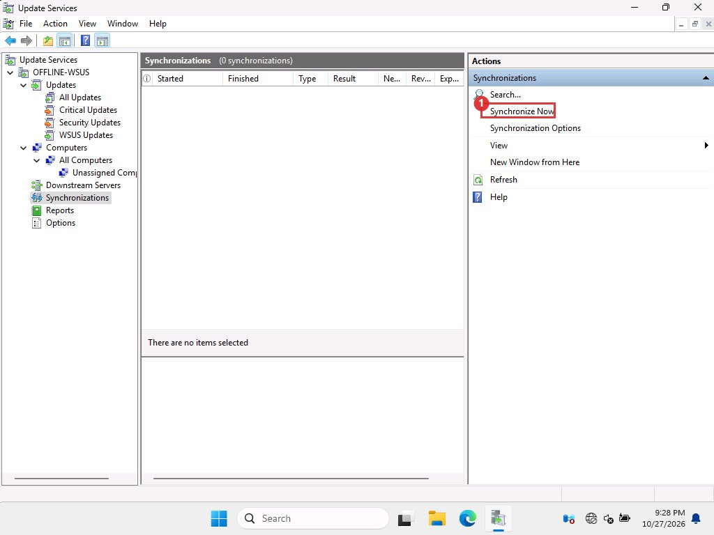{ loading=lazy }
      <figcaption>Synchronizations page. On the offline server this list stays empty, which is correct.</figcaption>
    </figure>

2. **Find the month's update <span class="tag gui">GUI</span>**

    *Online server, WSUS console*

    Click **Updates**, then **All Updates**. Set the <span class="mk">1</span> **Approval** drop-down to <span class="mk">1</span> **Unapproved** and click **Refresh**. Windows 11 monthly updates are titled *YYYY-MM Cumulative Update for Windows 11, version 25H2 for x64-based Systems*.

    <figure markdown="span">
      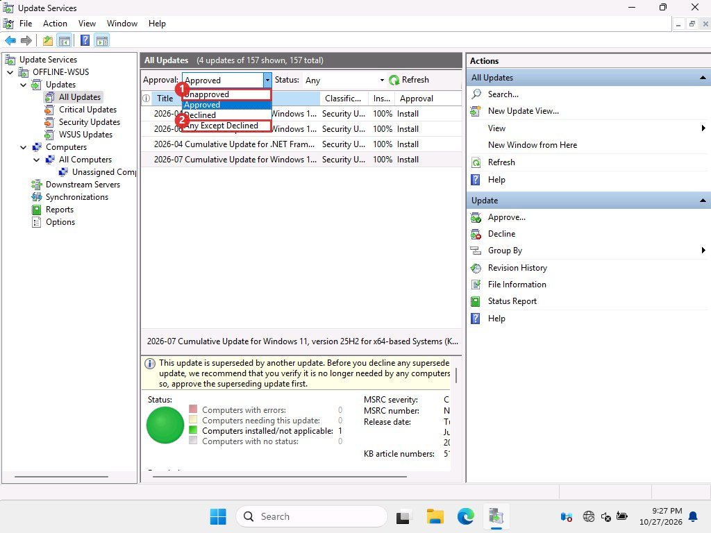{ loading=lazy }
      <figcaption>Approval filter. Choices: Unapproved, Approved, Declined, Any Except Declined.</figcaption>
    </figure>

    To jump straight to one, click **Search…** in the Actions pane, type the KB number, then **Find Now**.

    <figure markdown="span">
      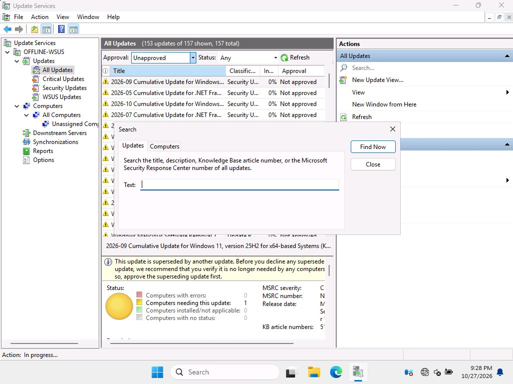{ loading=lazy }
      <figcaption>Search dialog. It searches the title, description and KB number.</figcaption>
    </figure>

    WSUS marks every month except the newest as superseded and shows a yellow warning. That does not stop you approving an older one.

3. **Check the size <span class="tag cli">CLI</span>**

    *Online server*

    Select the update, then click **File Information** in the Actions pane. This lists every file with its size, as the next screenshot shows. The total, and which files you already hold, needs script 2. Expect about 5 GB new. If it is much larger, stop and find out why. Make sure free space is at least double the new size (files plus the carry archive).

    <figure markdown="span">
      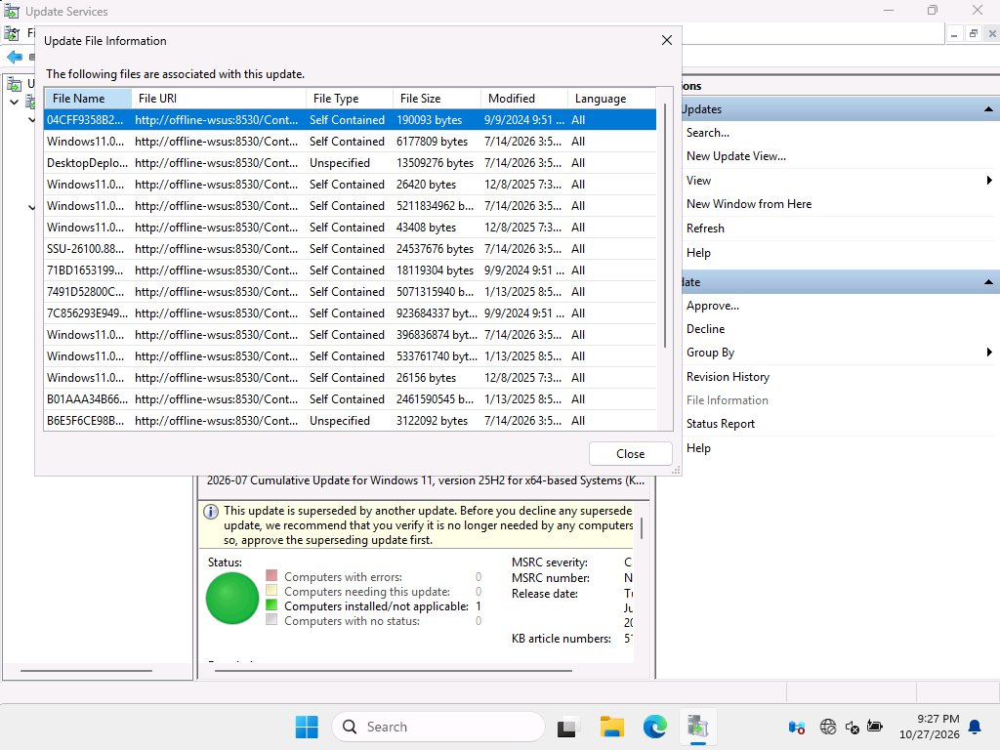{ loading=lazy }
      <figcaption>File Information for the July update. The columns are file name, source, type, size and date.</figcaption>
    </figure>

4. **Take a safety copy <span class="tag gui">GUI</span>**

    *Hyper-V host, both servers and the test client*

    Open Hyper-V Manager. Click <span class="mk">1</span> the virtual machine, then in the Actions pane click <span class="mk">2</span> **Checkpoint**. A checkpoint appears in the *Checkpoints* box under the list. To go back later, select the checkpoint and click <span class="mk">3</span> **Revert…** (on the VM's own actions), or right-click the checkpoint and choose **Apply…**.

    <figure markdown="span">
      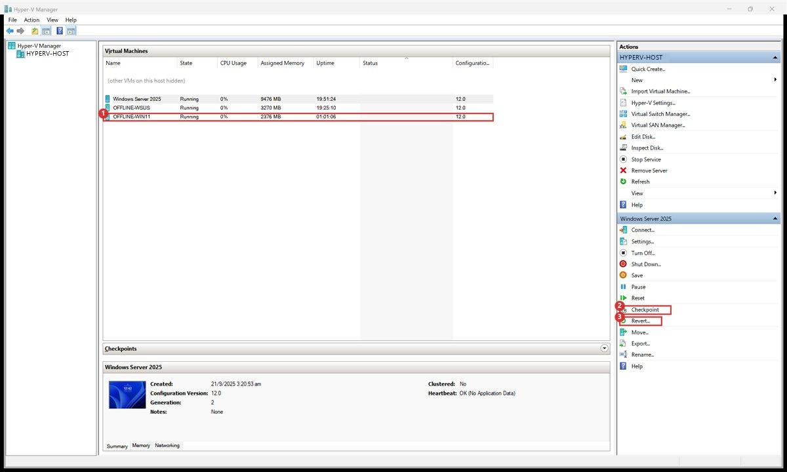{ loading=lazy }
      <figcaption>Hyper-V Manager. The Actions pane changes to match the selected VM. We hid our other VMs in this picture.</figcaption>
    </figure>

    !!! warning "Check it exists"

        Our VMs had checkpoints turned off, and the first attempt failed with "Checkpoints have been disabled". Open the VM's **Settings**, **Management**, **Checkpoints** and tick **Enable checkpoints**. Then look in the Checkpoints box to see the new one before you change anything. On physical machines use your backup tool.

5. **Approve the update <span class="tag gui">GUI</span>**

    *Online server, WSUS console*

    In the update list click <span class="mk">1</span> the update, then in the Actions pane click <span class="mk">2</span> **Approve…**. The right-click menu has the same **Approve…** and **Decline**.

    <figure markdown="span">
      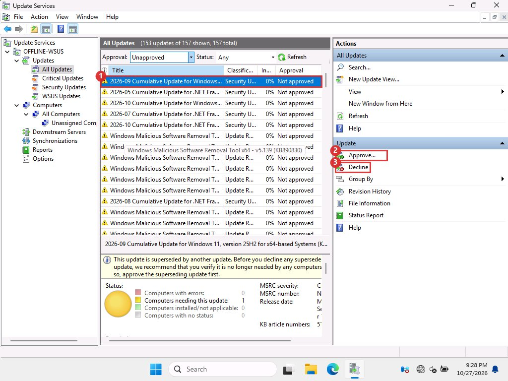{ loading=lazy }
      <figcaption>An unapproved update selected. Box 2 is Approve, box 3 is Decline.</figcaption>
    </figure>

    In the *Approve Updates* box, click the small arrow <span class="mk">1</span> next to **All Computers**.

    <figure markdown="span">
      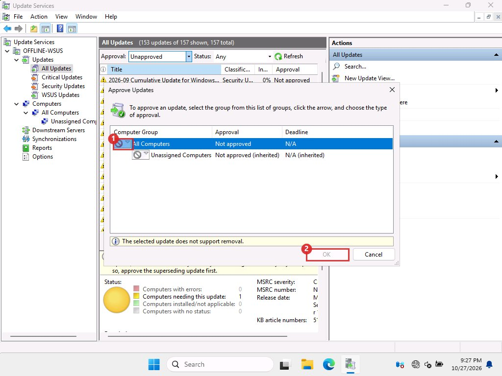{ loading=lazy }
      <figcaption>Approve Updates. OK stays grey until you choose something.</figcaption>
    </figure>

    Choose <span class="mk">1</span> **Approved for Install**, then click **OK**. A progress box appears. Click **Close** when it finishes.

    <figure markdown="span">
      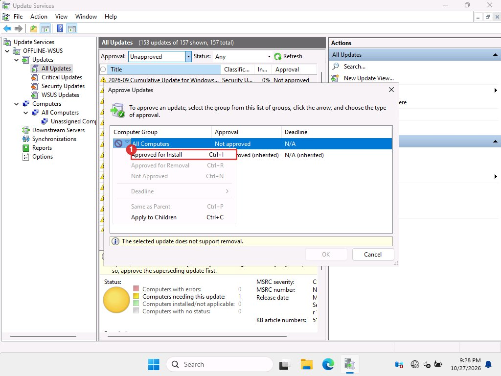{ loading=lazy }
      <figcaption>Menu from the arrow. &quot;The selected update does not support removal&quot; is normal for a cumulative update.</figcaption>
    </figure>

    Approve only this one update. Do not approve the whole list.

6. **Watch the download <span class="tag cli">CLI</span>**

    *Online server*

    WSUS now downloads the files. Watch with script 4, which prints how many of the update's files are complete. A healthy download finishes in a few minutes. If a file stays at 0 bytes, go to [Fixing problems](troubleshooting.md), first entry. Do not wait hours.

    !!! note "Not a re-download"

        The console and queue counters list every approved update as downloading. Only the missing files are fetched. Check what is missing with script 2.

7. **Verify every file <span class="tag cli">CLI</span>**

    *Online server*

    Run script 5. Every file's SHA-1 must equal its file name. Fix any mismatch before you carry anything.

8. **Export the catalog <span class="tag cli">CLI</span>**

    *Online server*

    ```powershell title="powershell"
    New-Item -ItemType Directory C:\Transfer -Force | Out-Null
    & "$env:ProgramFiles\Update Services\Tools\wsusutil.exe" export C:\Transfer\export.xml.gz C:\Transfer\export.log
    ```

    The file always holds the whole catalog. It was about 86 MB in our first runs, before we trimmed, and 3.1 MB afterwards with 181 updates. Read `export.log` for errors.

9. **Carry the new files and the catalog <span class="tag cli">CLI</span> or <span class="tag gui">File Explorer</span>**

    *Online server, removable drive, offline server*

    Script 6 builds one archive of only the files the offline server lacks. Copy the archive and `export.xml.gz` to the removable drive with File Explorer (copy, then paste on the drive), and later from the drive to `C:\Transfer` on the offline server. In the lab, 5.4 GB took about 1.5 minutes per hop.

10. **Extract and verify on the offline server <span class="tag cli">CLI</span>**

    *Offline server*

    Run script 7 to extract the archive into the content folder and compare every new file's SHA-1 with its name.

    !!! warning "Order matters"

        Content first, catalog second. The offline server then finds every file already in place when it learns about the update.

11. **Import the catalog <span class="tag cli">CLI</span>**

    *Offline server*

    ```powershell title="powershell"
    & "$env:ProgramFiles\Update Services\Tools\wsusutil.exe" import C:\Transfer\export.xml.gz C:\Transfer\import.log
    ```

    WSUS stops while it imports. It takes a few minutes. Read `import.log` afterwards.

    !!! note "What we did differently"

        In the lab the offline server had already imported a catalog taken after the online server synced through October. June and July were already known, so we only carried files. In a real month you export and import every time. We tested a real catalog import with the small .NET update, and later with the Server 2025 product (a 3.1 MB export that took 0.4 minutes to import and took the offline catalog from 157 to 181 updates).

12. **Trim old updates <span class="tag gui">GUI</span> for a few, <span class="tag cli">CLI</span> for many**

    *Offline server, WSUS console*

    The import brings back every update in the catalog, including ones you declined last month. To hide the old ones, set **Approval** to **Any Except Declined**, select the old rows (click the first, hold <kbd>Shift</kbd> and click the last), and click **Decline** in the Actions pane. For the first trim, which can be hundreds of rows, script 8 does it in one go. See [Cleanup and retention](cleanup.md).

13. **Approve on the offline server and check <span class="tag gui">GUI</span>**

    *Offline server, WSUS console*

    Click **All Updates**, set **Approval** to **Any Except Declined**, click **Refresh**, and select the new month's update. Click **Approve…**, set **All Computers** to **Approved for Install**, then **OK**, exactly as in step 5. Then run `wsusutil reset` (script 9) so the server registers the files.

    To check, select the update. The bottom pane shows *Computers needing this update* and, once clients install it, *Computers installed/not applicable*. Click **File Information** to confirm the files are listed.

    <figure markdown="span">
      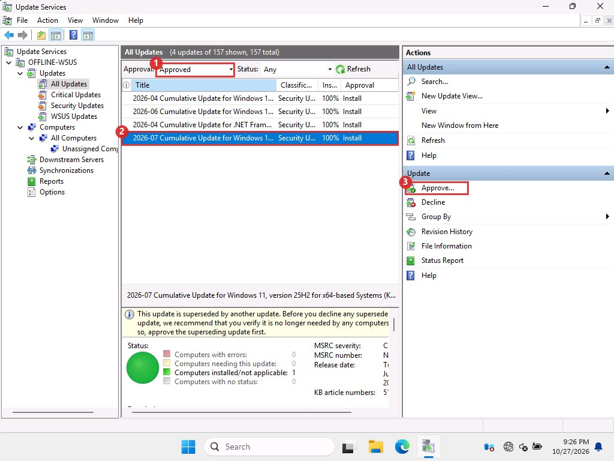{ loading=lazy }
      <figcaption>Approved updates on the offline server. Box 2 is the selected update. The green circle at the bottom means one computer has installed it.</figcaption>
    </figure>

    You can also right-click the update to get the same actions.

    <figure markdown="span">
      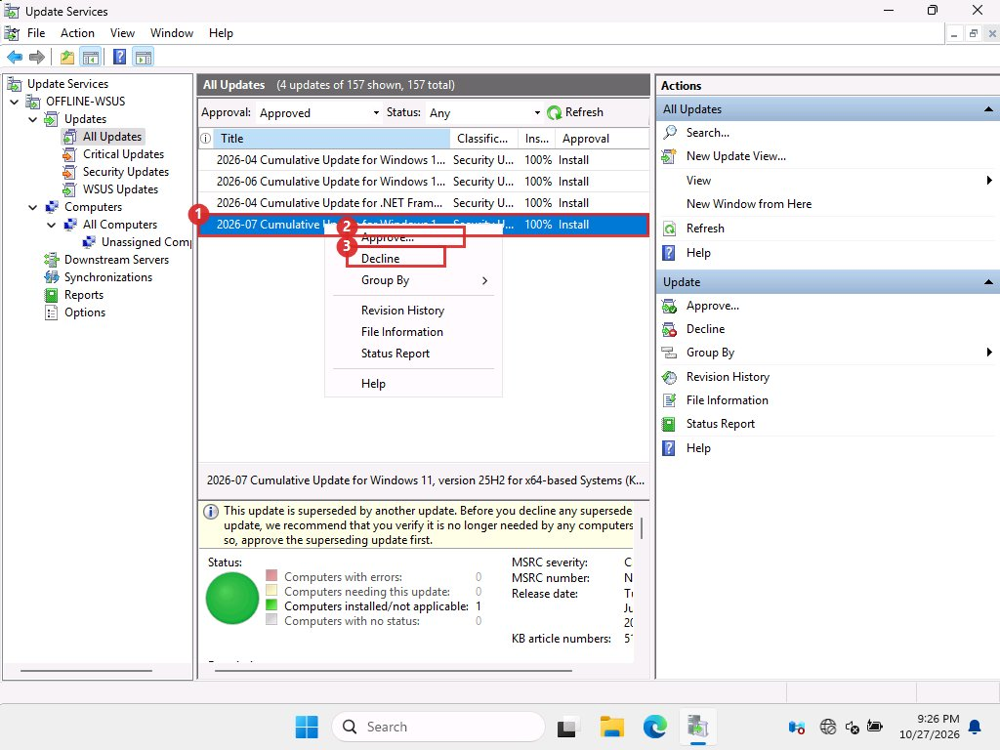{ loading=lazy }
      <figcaption>Right-click menu. Box 2 is Approve…, box 3 is Decline.</figcaption>
    </figure>

14. **See which computers have it <span class="tag gui">GUI</span>**

    *Offline server, WSUS console*

    Click **Computers**, then **All Computers**. Click <span class="mk">1</span> the computer to see how many updates it needs and has installed.

    <figure markdown="span">
      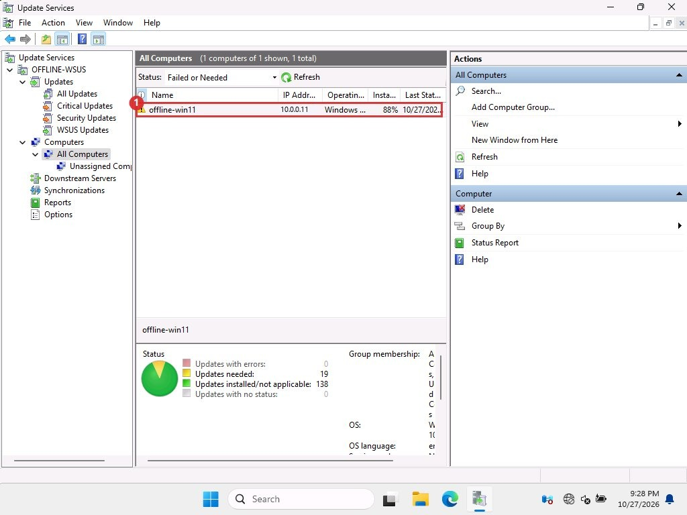{ loading=lazy }
      <figcaption>The client reports to the offline server. Columns include its IP address, operating system and last status report.</figcaption>
    </figure>

15. **Test, then roll out**

    *Test client, then everyone*

    Install on the test client first ([Installing on the client](client-install.md)). Approve for the wider estate only after that client has booted and run for a day.

16. **Clean up the transfer files <span class="tag gui">GUI</span>**

    *Both servers and the removable drive*

    In File Explorer delete the archive and export files from `C:\Transfer` and from the drive. They were 18.8 GB per machine in our lab by the end. Do not touch the WSUS content folder.
