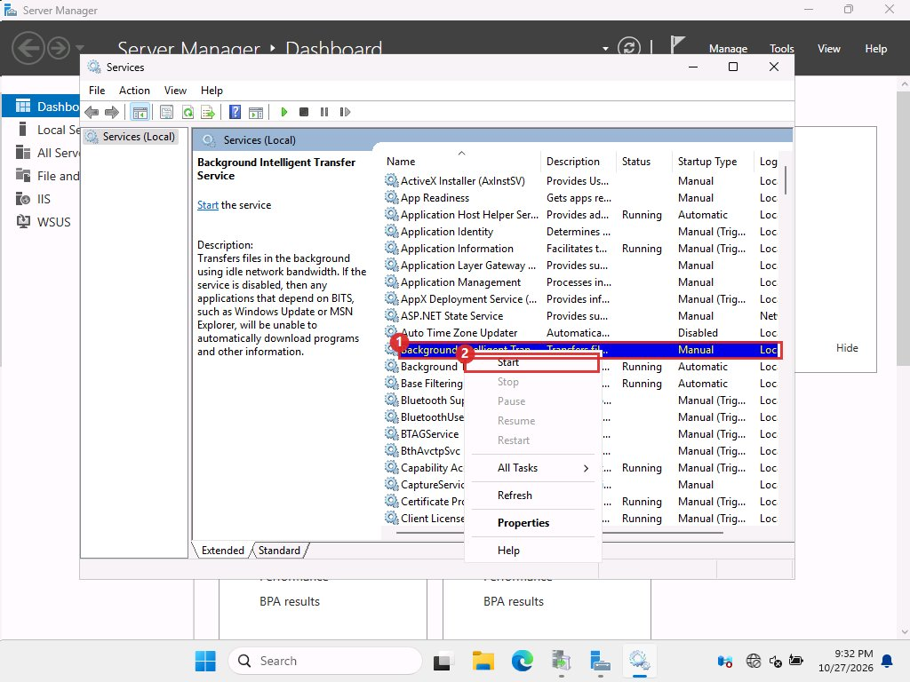

# Fixing problems

Each entry lists what you see, what we think is behind it, and the fixes in the order we would try them. Where a cause is unproven, we say so.

???+ note "Download stuck at 0 MB online WSUS"

    **What you see.** After approving, the WSUS download shows 0 of N MB for minutes. `Get-BitsTransfer -AllUsers` lists jobs, the first one "Transferring" at 0 bytes and the rest "Queued". Disk use does not grow.

    **What we know.** The network and the Microsoft servers were fine every time. A plain `curl.exe` from the same server downloaded a 5.2 GB file at 60 MB/s while BITS sat at zero. The BITS client log showed jobs hitting `0x80072EE2` (operation timed out) and then waiting 10 minutes before retrying, which is BITS's default retry delay. We never found the root cause.

    **Fixes, in order.**

    1. Turn on foreground priority and restart WSUS. This is documented by Microsoft as the way to avoid the HTTP Range header that background jobs use. In our lab it unblocked the last stuck file instantly. Two later downloads with the setting on (the August client update, 5.3 GB, and the Server 2025 update, 4 GB) finished in about 2 minutes each with no stall.

        ```powershell title="powershell on the online server"
        $c = (Get-WsusServer).GetConfiguration()
        $c.BitsDownloadPriorityForeground = $true
        $c.Save()
        Restart-Service WsusService -Force
        ```

    2. Restart BITS. This forces an immediate retry instead of waiting the 10 minutes. It fixed the April stall. If a file is still at 0 after 90 seconds, restart it again, up to a few times.

        <span class="tag gui">GUI</span> In Server Manager click **Tools**, then **Services**. Click <span class="mk">1</span> **Background Intelligent Transfer Service**, then right-click it and click <span class="mk">2</span> **Restart**. In this picture the service was stopped, so the menu offers Start and Restart is grey. On a server that is mid-download the service is running and Restart is available.

        <figure markdown="span">
          { loading=lazy }
          <figcaption>Services console, right-click menu on the BITS service.</figcaption>
        </figure>

        <span class="tag cli">CLI</span> `Restart-Service BITS -Force`

    3. Stop WSUS and BITS together, then start BITS and WSUS again. The BITS queue is stored in `C:\ProgramData\Microsoft\Network\Downloader`. Guides suggest renaming the queue files while BITS is stopped. We tried that, but on Server 2025 the files are `qmgr.db` and `qmgr.jfm`, and our command looked for `qmgr*.dat`, so nothing was renamed. The jobs began to move after that restart anyway. Renaming the queue files is untested here.

        ```powershell title="powershell on the online server"
        Stop-Service WsusService -Force
        Stop-Service BITS -Force

        Start-Service BITS
        Start-Service WsusService
        ```

    4. Run `wsusutil reset`. It re-checks every file and cleans the queue. It was needed once, and in one case it did not help.

    **Things that did not work.** `Remove-BitsTransfer` and `bitsadmin /reset /allusers` could not cancel the jobs, which belong to NETWORK SERVICE. WSUS recreates them within seconds anyway.

    **Do not** download the files by hand and drop them into the content folder. We decided against it. It sidesteps the problem instead of fixing it, and WSUS only trusts files it registered.

??? note "The last file keeps failing with TransientError online WSUS"

    **What you see.** 18 of 19 files done, the last job in `TransientError`, error `0x80072EE2`, retry in 10 minutes.

    **Fix.** Apply the foreground priority change above, or restart BITS to retry immediately. Watch with script 4 and stop restarting once the file count is complete.

??? note "&quot;4 updates downloading&quot; in the console online WSUS"

    All approved updates appear in the WSUS download queue, and `wsusutil reset` makes the queue show all of them again at full size. Check which files are really missing with script 2. In our lab, only the new month's files were missing and nothing already on disk was fetched again.

??? note "Carried files are on disk but WSUS does not use them offline WSUS"

    **What you see.** The update is in the console, the files are in the content folder, but clients are not offered it, or the console says the update has no files.

    **Fix.** Approve the update first, then run `wsusutil reset`. In our lab the offline server registered the files only after approval. Wait for the reset to finish before testing.

??? note "The client is offered 0 updates after approval client"

    The client policy was correct and the scan completed without errors. The update showed up after about 20 minutes, in April and again in July. Keep rescanning (script 10 does it once a minute). If it never appears after an hour, check: the update is approved for All Computers, the files are present, the client's `WUServer` value is right, and the client can reach port 8530.

    Once a newer CU is approved, the client is only offered that one. It does not see the older ones separately.

??? note "Install fails at restart with 0x800F0922 client"

    **What happened.** The April update reported success, then at the restart Windows rolled back. The history showed `code=4 hr=0x800F0922`. The servicing log named a per-user registry installer error ("file not found").

    **What worked.** We tried again, restarted gracefully, and left the VM untouched for 25 minutes. It succeeded. The cause is unproven. Our guess was the automated login during servicing, but a later failure (June) happened with no login at all, so that guess is not reliable.

    **If it repeats.** Check free space on C: and on the EFI partition, run the retry hands-off, and read `C:\Windows\Logs\CBS\CBS.log`. Web reports tie some 0x800f0922 failures to Secure Boot or a full EFI partition.

??? note "Client does not boot after the update (Automatic Repair) client"

    **What happened.** After the June 2026 CU and its restart, the client showed "Automatic Repair couldn't repair your PC" and never came back. Its heartbeat stayed at NoContact for 3 hours.

    **What the logs showed.** We powered the VM off, mounted its disk read-only on the host, and read the setup log. The installer tried to copy a new boot manager file, `bootmgfw_EX.efi`, to the EFI partition and failed 60 times, then failed to read the boot configuration from `\EFI\Microsoft\Boot\BCD`.

    **Likely link.** Web coverage says KB5094126 caused startup failures and BitLocker prompts on some machines, tied to a Secure Boot certificate refresh and EFI partitions short on space. Microsoft had not confirmed it when we looked. We never measured our client's EFI partition, so this match is likely, not proven. The July update, which includes the same family of changes, installed and booted fine on the same VM.

    **Fix.** Restore the checkpoint taken before the install. That is why you take one.

    ```powershell title="powershell on the Hyper-V host"
    Stop-VM -Name CLIENT -TurnOff -Force
    Restore-VMSnapshot -VMSnapshot (Get-VMSnapshot -VMName CLIENT -Name 'before-update') -Confirm:$false
    Start-VM -Name CLIENT
    ```

    To read the failure logs from the host instead, power the VM off, run `Mount-VHD -Path DISK.avhdx -ReadOnly`, read `D:\Windows\Panther\setuperr.log` and `D:\Windows\Logs\CBS\CBS.log`, then `Dismount-VHD`.

    For a physical machine, boot from Windows installation media into the recovery environment and use the System Restore point or uninstall the update there, with the BitLocker key ready.

??? note "Hash mismatch after carrying files offline WSUS"

    Each content file is named after its SHA-1, so script 7 can prove it arrived intact. If any file mismatches, copy that file again from the online server, and check it there with script 5. Never import a catalog for an update whose files fail the check.

??? note "sqlcmd is not installed both servers"

    Reindexing needs SQL commands against SUSDB, which lives in WID. `sqlcmd` is not installed by the WSUS role. Use .NET's SqlClient over the WID named pipe, as script 8 does: `Data Source=np:\\.\pipe\MICROSOFT##WID\tsql\query;Initial Catalog=SUSDB;Integrated Security=True`.

??? note "Old or unwanted updates come back after an import offline WSUS"

    The catalog import brings in everything that is in the export, and declines and approvals are not carried. Trim the online server first with script 8 and export after that, so the export is already small. When we did this, the offline catalog came out with exactly the same count as the online one (181) and nothing we had deleted reappeared. If the online server still holds old records, expect the import to bring them back, so re-run script 8 on the offline server after each import.

??? note "WSUS log shows SQL deadlock errors (1205) online WSUS"

    `SoftwareDistribution.log` showed deadlock retries and "CatalogSyncAgent not running" during heavy downloads. We saw it while things also worked and never proved it harmful. Keep it in mind if downloads fail with no other clue. Reindexing SUSDB is the usual first step.

??? note "Checkpoint says &quot;Checkpoints have been disabled&quot; Hyper-V host"

    The VMs we built had checkpoints off. Run `Set-VM -Name NAME -CheckpointType Production` and take the checkpoint again. Check the result with `Get-VMSnapshot -VMName NAME`. Our script carried on after a failed checkpoint once. Add an explicit check for the checkpoint before changing anything.

??? note "A product's updates are missing after the trim online WSUS"

    **What you see.** You tick a product that was trimmed earlier (we needed Server 2025), sync, and the console still has none of its updates. A sync result of *Succeeded* in a few seconds with no change in the update count is the sign.

    **Why.** WSUS only sends changes since the last sync, and you deleted those records.

    **Fix.** In the console click **Options**, then **Products and Classifications**, untick the product, click **OK**, sync, then tick it again and sync a second time. The updates return, with the old months. Run script 8 afterwards.

    <span class="tag cli">CLI</span> The same from PowerShell on the online server. Replace the product title with yours. This lab had two products ticked. The last two lines turn the product off and sync, then turn it on again and sync.

    ```powershell title="powershell on the online server"
    $w = Get-WsusServer
    $s = $w.GetSubscription()

    function SetProducts($titles) {
      $c = New-Object Microsoft.UpdateServices.Administration.UpdateCategoryCollection
      foreach ($t in $titles) {
        [void]$c.Add(($w.GetUpdateCategories() | Where-Object Title -eq $t))
      }
      $s.SetUpdateCategories($c)
      $s.Save()
    }

    function SyncAndWait {
      $s.StartSynchronization()
      Start-Sleep 20
      while ($s.GetSynchronizationStatus() -ne 'NotProcessing') {
        Start-Sleep 30
      }
    }

    SetProducts @('Windows 11')
    SyncAndWait

    SetProducts @('Windows 11','Microsoft Server Operating System-24H2')
    SyncAndWait
    ```
